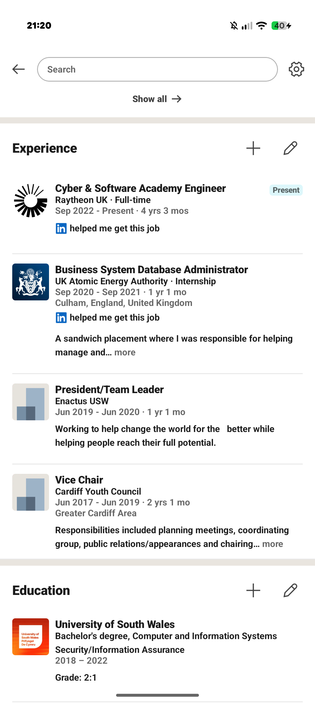
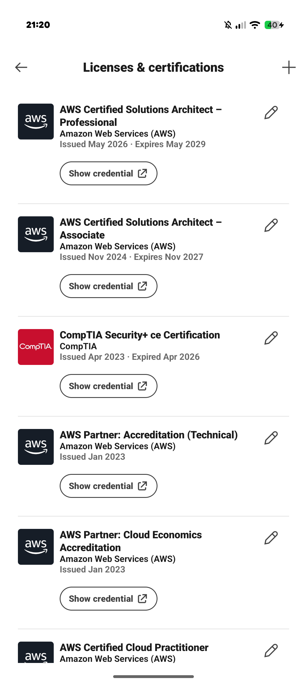
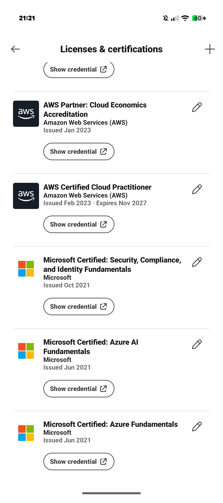

<!-- KAINBAIN AUTO-GENERATED REPORT -->
# Stage Report: Plan

**Task:** can you please update my credentials This is quite out of date     This is my latest linkedin
**Stage Type:** `agent`
**Model:** `default`
**Duration:** 123.726s
**Status:** FAILED

### Summary of Changes
Execution failed: [Agent Review Rejection] The task folder `docs/tasks/5607d487-3322-43f0-8bfd-84adb750b7bf/` is missing from the working tree, including the previous report (`idea-20261124-212152.md`) and all three LinkedIn screenshot assets (`assets/19241.png`, `assets/19242.png`, `assets/19243.png`) needed to determine what credentials to update. Fix guidance: Ensure the task directory `docs/tasks/5607d487-3322-43f0-8bfd-84adb750b7bf/` with `idea-20261124-212152.md` and `assets/19241.png`, `assets/19242.png`, and `assets/19243.png` is synced/checked out into the task branch `kb/5607d487-3322-43f0-8bfd-84adb750b7bf` worktree, then re-run this planning stage so the agent can read the screenshots and author `IMPLEMENTATION_PLAN.md`.

### Execution Output
```
I inspected the repository and attempted to read the task's previous report (`docs/tasks/5607d487-3322-43f0-8bfd-84adb750b7bf/idea-20261124-212152.md`) and the three LinkedIn screenshot assets (`assets/19241.png`, `assets/19242.png`, `assets/19243.png`) required to plan the credential updates. The directory `docs/tasks/5607d487-3322-43f0-8bfd-84adb750b7bf/` does not exist anywhere in the workspace (`/home/[REDACTED]/.kainbain/runner-work/kb-5607d487-3322-43f0-8bfd-84adb750b7bf`), and branch `kb/5607d487-3322-43f0-8bfd-84adb750b7bf` is at commit `7478e01` (`main`) with a clean working tree and none of the referenced task files or images present. Because the screenshots containing the updated LinkedIn credentials are missing, I cannot create an accurate `IMPLEMENTATION_PLAN.md` without fabricating credential details, so no files were modified.

KAINBAIN_VERDICT: FAIL
KAINBAIN_REASON: The task folder `docs/tasks/5607d487-3322-43f0-8bfd-84adb750b7bf/` is missing from the working tree, including the previous report (`idea-20261124-212152.md`) and all three LinkedIn screenshot assets (`assets/19241.png`, `assets/19242.png`, `assets/19243.png`) needed to determine what credentials to update.
KAINBAIN_FIX: Ensure the task directory `docs/tasks/5607d487-3322-43f0-8bfd-84adb750b7bf/` with `idea-20261124-212152.md` and `assets/19241.png`, `assets/19242.png`, and `assets/19243.png` is synced/checked out into the task branch `kb/5607d487-3322-43f0-8bfd-84adb750b7bf` worktree, then re-run this planning stage so the agent can read the screenshots and author `IMPLEMENTATION_PLAN.md`.

```

### Modified Files
- (No files modified / inspection only)

### Verification Status
- Stage execution failed with error: [Agent Review Rejection] The task folder `docs/tasks/5607d487-3322-43f0-8bfd-84adb750b7bf/` is missing from the working tree, including the previous report (`idea-20261124-212152.md`) and all three LinkedIn screenshot assets (`assets/19241.png`, `assets/19242.png`, `assets/19243.png`) needed to determine what credentials to update. Fix guidance: Ensure the task directory `docs/tasks/5607d487-3322-43f0-8bfd-84adb750b7bf/` with `idea-20261124-212152.md` and `assets/19241.png`, `assets/19242.png`, and `assets/19243.png` is synced/checked out into the task branch `kb/5607d487-3322-43f0-8bfd-84adb750b7bf` worktree, then re-run this planning stage so the agent can read the screenshots and author `IMPLEMENTATION_PLAN.md`.
- Triggered fallback routing.