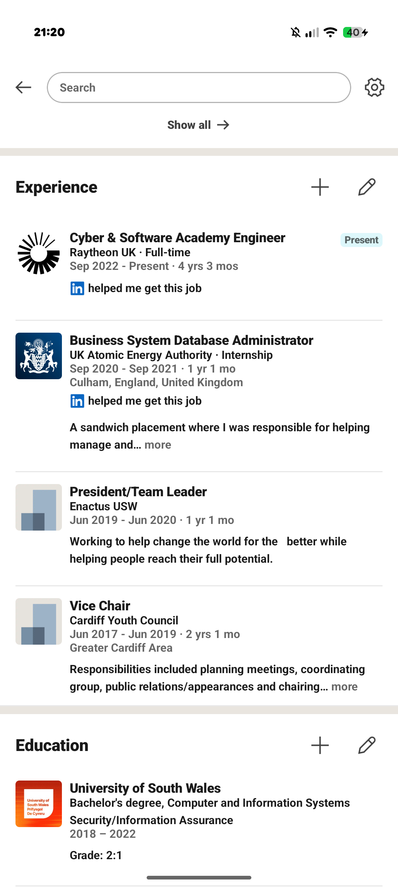
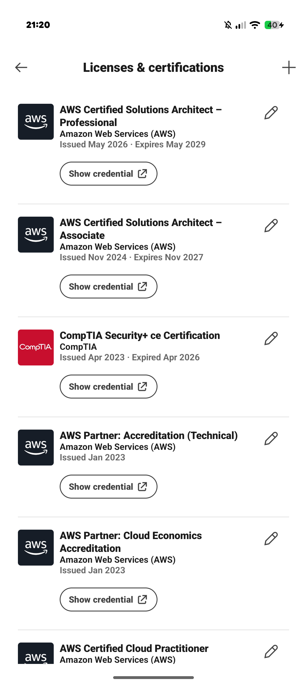
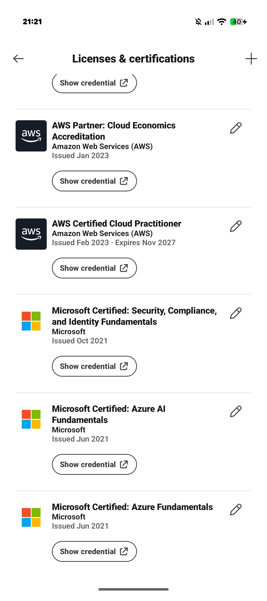

# Goal
# can you please update my credentials

This is quite out of date 






This is my latest linkedin

# History
- 2026-11-24T21:20:14.294Z: Created and placed in stage 'Idea'
- 2026-11-24T21:20:14.939Z: Synced default branch 'main' to 'origin/main' before task-branch pickup (7478e01 → 7478e01) discarded 5 tracked path(s) on 'main' (remote is authoritative; prior state in reflog)
- 2026-11-24T21:20:15.203Z: Created and checked out task branch 'kb/5607d487-3322-43f0-8bfd-84adb750b7bf' from 'main'
- 2026-11-24T21:20:21.253Z: Task details edited
- 2026-11-24T21:20:25.144Z: Task details edited
- 2026-11-24T21:20:27.603Z: Task details edited
- 2026-11-24T21:20:30.471Z: Task details edited
- 2026-11-24T21:21:32.628Z: Task details edited
- 2026-11-24T21:21:38.363Z: Task details edited
- 2026-11-24T21:21:46.910Z: Task details edited
- 2026-11-24T21:21:52.086Z: Stage report generated: ./docs/tasks/5607d487-3322-43f0-8bfd-84adb750b7bf/idea-20261124-212152.md
- 2026-11-24T21:21:52.087Z: Advanced to stage 'Plan'
- 2026-11-24T21:21:52.120Z: Task-branch ref 'kb/5607d487-3322-43f0-8bfd-84adb750b7bf' already exists — no checkout performed (human checkpoint 'Idea'; leaving 7 uncommitted paths in the tree for the next work stage)
- 2026-11-24T21:21:57.185Z: Runner server2-alpha stage stage-1791833613563-1: started
- 2026-11-24T21:21:58.303Z: Runner server2-alpha stage stage-1791833613563-1: prompted
- 2026-11-24T21:23:52.411Z: Runner server2-alpha stage stage-1791833613563-1: finished
- 2026-11-24T21:23:55.439Z: Runner completed execution f0e84a30-c5d0-4abc-a282-012b2f015df9 (runner server2-alpha, epoch 1, sha 7478e01ea9a9d6ab6929a77ee09c3ede42676ac6 (unverified-remote), branch kb/5607d487-3322-43f0-8bfd-84adb750b7bf, posture T0/T1:antigravity:antigravity::antigravity::gemini-4-neon-medium). Lease released. [attestation task=5607d487-3322-43f0-8bfd-84adb750b7bf stage=stage-1791833613563-1 config=sha256:c94f577165d1c8c39de148053f7a263b540499d4c07953b10b5132bb4f41864e commit=none]
- 2026-11-24T21:23:55.527Z: Auto-committed partial work on 'kb/5607d487-3322-43f0-8bfd-84adb750b7bf' (afe8a4f) after failed stage 'Plan'
- 2026-11-24T21:23:55.810Z: Warning: push of 'kb/5607d487-3322-43f0-8bfd-84adb750b7bf' after failed stage 'Plan' failed (git push -u origin kb/5607d487-3322-43f0-8bfd-84adb750b7bf failed (exit 128): fatal: could not read Username for 'https://github.com': No such device or address) — retry still proceeds
- 2026-11-24T21:23:55.812Z: Stage failed in 'Plan': [Agent Review Rejection] The task folder `docs/tasks/5607d487-3322-43f0-8bfd-84adb750b7bf/` is missing from the working tree, including the previous report (`idea-20261124-212152.md`) and all three LinkedIn screenshot assets (`assets/19241.png`, `assets/19242.png`, `assets/19243.png`) needed to determine what credentials to update. Fix guidance: Ensure the task directory `docs/tasks/5607d487-3322-43f0-8bfd-84adb750b7bf/` with `idea-20261124-212152.md` and `assets/19241.png`, `assets/19242.png`, and `assets/19243.png` is synced/checked out into the task branch `kb/5607d487-3322-43f0-8bfd-84adb750b7bf` worktree, then re-run this planning stage so the agent can read the screenshots and author `IMPLEMENTATION_PLAN.md`.
- 2026-11-24T21:23:55.813Z: Stage report generated: ./docs/tasks/5607d487-3322-43f0-8bfd-84adb750b7bf/plan-failure-20261124-212355.md
- 2026-11-24T21:23:55.817Z: Failed back to stage 'Idea'

# Timeline
- 2026-11-24T21:21:52.087Z: Plan | Advanced | 97.793s
- 2026-11-24T21:23:55.812Z: Plan | Failed | 123.725s
- 2026-11-24T21:23:55.817Z: Idea | Moved | 123.73s

# Log Entries
```json
[{"id":"log-10297","ts":"2026-11-24T21:20:14.939Z","feed":"main","feeds":["main"],"kind":"system","turn":null,"text":"[GIT] Synced default branch 'main' to 'origin/main' before task-branch pickup (7478e01 → 7478e01) discarded 5 tracked path(s) on 'main' (remote is authoritative; prior state in reflog)","meta":{"source":"process-log"}},{"id":"log-10298","ts":"2026-11-24T21:20:15.203Z","feed":"main","feeds":["main"],"kind":"system","turn":null,"text":"[GIT] Created and checked out task branch 'kb/5607d487-3322-43f0-8bfd-84adb750b7bf' from 'main'","meta":{"source":"process-log"}},{"id":"log-10303","ts":"2026-11-24T21:21:52.087Z","feed":"main","feeds":["main"],"kind":"system","turn":null,"text":"[INFO] Advanced from stage 'Idea' to stage 'Plan'","meta":{"source":"process-log"}},{"id":"log-10304","ts":"2026-11-24T21:21:52.120Z","feed":"main","feeds":["main"],"kind":"system","turn":null,"text":"[GIT] Task-branch ref 'kb/5607d487-3322-43f0-8bfd-84adb750b7bf' already exists — no checkout performed (human checkpoint 'Idea'; leaving 7 uncommitted paths in the tree for the next work stage)","meta":{"source":"process-log"}},{"id":1,"ts":"2026-11-24T21:22:03.456Z","feed":"main","feeds":["main"],"kind":"system","turn":1,"text":"[AGY] run open: model=gemini-4-neon-medium sandbox=off approvals=auto permission_mode=always-proceed conversation=37f05952","meta":{"source":"runner-structured","runnerId":"server2-alpha","executionId":"f0e84a30-c5d0-4abc-a282-012b2f015df9","seq":0},"fidelity":"synthesized","seq":1},{"id":2,"ts":"2026-11-24T21:22:03.456Z","feed":"main","feeds":["main"],"kind":"system","turn":1,"text":"[AGY] step (step ?)","meta":{"source":"runner-structured","runnerId":"server2-alpha","executionId":"f0e84a30-c5d0-4abc-a282-012b2f015df9","seq":0},"fidelity":"synthesized","seq":2},{"id":3,"ts":"2026-11-24T21:23:52.101Z","feed":"telemetry","feeds":["telemetry"],"kind":"telemetry","turn":1,"text":"[USAGE] tokens=29463/5409/34872","meta":{"model":null,"source":"runner-structured","runnerId":"server2-alpha","executionId":"f0e84a30-c5d0-4abc-a282-012b2f015df9","seq":1},"fidelity":"synthesized","seq":3,"usage":{"input_tokens":29463,"output_tokens":5409,"thinking_tokens":3495,"cache_read_tokens":72073,"total_tokens":34872}},{"id":4,"ts":"2026-11-24T21:23:52.102Z","feed":"main","feeds":["main"],"kind":"system","turn":1,"text":"[AGY] run done: status=SUCCESS in 108.9s · 34872 tokens","meta":{"source":"runner-structured","runnerId":"server2-alpha","executionId":"f0e84a30-c5d0-4abc-a282-012b2f015df9","seq":1},"fidelity":"synthesized","seq":4},{"id":"log-10309","ts":"2026-11-24T21:23:55.378Z","feed":"main","feeds":["main"],"kind":"runner","turn":null,"text":"[runner server2-alpha] stage output: I inspected the repository and attempted to read the task's previous report (`docs/tasks/5607d487-3322-43f0-8bfd-84adb750b7bf/idea-20261124-212152.md`) and the three LinkedIn screenshot assets (`assets/19241.png`, `assets/19242.png`, `assets/19243.png`) required to plan the credential updates. The directory `docs/tasks/5607d487-3322-43f0-8bfd-84adb750b7bf/` does not exist anywhere in the workspace (`/home/[REDACTED]/.kainbain/runner-work/kb-5607d487-3322-43f0-8bfd-84adb750b7bf`), and branch `kb/5607d487-3322-43f0-8bfd-84adb750b7bf` is at commit `7478e01` (`main`) with a clean working tree and none of the referenced task files or images present. Because the screenshots containing the updated LinkedIn credentials are missing, I cannot create an accurate `IMPLEMENTATION_PLAN.md` without fabricating credential details, so no files were modified.","meta":{"source":"process-log","runnerId":"server2-alpha","executionId":"f0e84a30-c5d0-4abc-a282-012b2f015df9","seq":0}},{"id":"log-10310","ts":"2026-11-24T21:23:55.403Z","feed":"main","feeds":["main"],"kind":"runner","turn":null,"text":"[runner server2-alpha] KAINBAIN_VERDICT: FAIL","meta":{"source":"process-log","runnerId":"server2-alpha","executionId":"f0e84a30-c5d0-4abc-a282-012b2f015df9","seq":1}},{"id":"log-10311","ts":"2026-11-24T21:23:55.407Z","feed":"main","feeds":["main"],"kind":"runner","turn":null,"text":"[runner server2-alpha] KAINBAIN_REASON: The task folder `docs/tasks/5607d487-3322-43f0-8bfd-84adb750b7bf/` is missing from the working tree, including the previous report (`idea-20261124-212152.md`) and all three LinkedIn screenshot assets (`assets/19241.png`, `assets/19242.png`, `assets/19243.png`) needed to determine what credentials to update.","meta":{"source":"process-log","runnerId":"server2-alpha","executionId":"f0e84a30-c5d0-4abc-a282-012b2f015df9","seq":2}},{"id":"log-10312","ts":"2026-11-24T21:23:55.418Z","feed":"main","feeds":["main"],"kind":"runner","turn":null,"text":"[runner server2-alpha] KAINBAIN_FIX: Ensure the task directory `docs/tasks/5607d487-3322-43f0-8bfd-84adb750b7bf/` with `idea-20261124-212152.md` and `assets/19241.png`, `assets/19242.png`, and `assets/19243.png` is synced/checked out into the task branch `kb/5607d487-3322-43f0-8bfd-84adb750b7bf` worktree, then re-run this planning stage so the agent can read the screenshots and author `IMPLEMENTATION_PLAN.md`.","meta":{"source":"process-log","runnerId":"server2-alpha","executionId":"f0e84a30-c5d0-4abc-a282-012b2f015df9","seq":3}},{"id":"log-10313","ts":"2026-11-24T21:23:55.527Z","feed":"main","feeds":["main"],"kind":"system","turn":null,"text":"[GIT] Auto-committed partial work on 'kb/5607d487-3322-43f0-8bfd-84adb750b7bf' after failed stage 'Plan'","meta":{"source":"process-log"}},{"id":"log-10314","ts":"2026-11-24T21:23:55.812Z","feed":"main","feeds":["main"],"kind":"error","turn":null,"text":"[ERROR] [Agent Review Rejection] The task folder `docs/tasks/5607d487-3322-43f0-8bfd-84adb750b7bf/` is missing from the working tree, including the previous report (`idea-20261124-212152.md`) and all three LinkedIn screenshot assets (`assets/19241.png`, `assets/19242.png`, `assets/19243.png`) needed to determine what credentials to update. Fix guidance: Ensure the task directory `docs/tasks/5607d487-3322-43f0-8bfd-84adb750b7bf/` with `idea-20261124-212152.md` and `assets/19241.png`, `assets/19242.png`, and `assets/19243.png` is synced/checked out into the task branch `kb/5607d487-3322-43f0-8bfd-84adb750b7bf` worktree, then re-run this planning stage so the agent can read the screenshots and author `IMPLEMENTATION_PLAN.md`.","meta":{"source":"process-log"}},{"id":"log-10315","ts":"2026-11-24T21:23:55.817Z","feed":"main","feeds":["main"],"kind":"system","turn":null,"text":"[INFO] Failed back from stage 'Plan' to stage 'Idea'","meta":{"source":"process-log"}}]
```