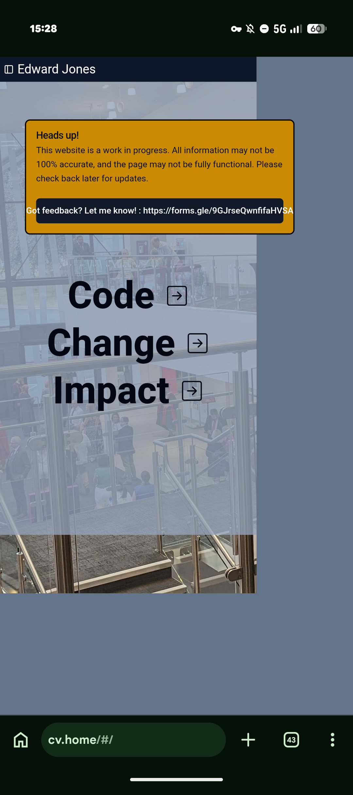

<!-- KAINBAIN AUTO-GENERATED REPORT -->
# Stage Report: Deploy dev

**Task:** Please make sure the mobile version works.   It currently looks rough and want it to behave nicer
**Stage Type:** `ci`
**Model:** `default`
**Duration:** 1.542s
**Status:** FAILED

### Summary of Changes
Execution failed: CI command failed with exit code 1

### Execution Output
```
Unknown argument: start

```

### Modified Files
- (No files modified / inspection only)

### Verification Status
- Stage execution failed with error: CI command failed with exit code 1
- Triggered fallback routing.