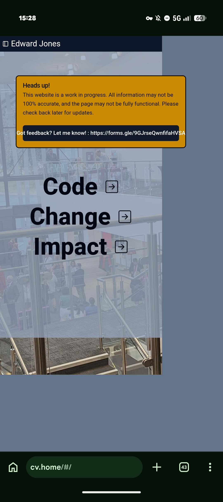

<!-- KAINBAIN AUTO-GENERATED REPORT -->
# Stage Report: Quick review

**Task:** Please make sure the mobile version works.   It currently looks rough and want it to behave nicer
**Stage Type:** `agent`
**Model:** `default`
**Duration:** 164.368s
**Status:** FAILED

### Summary of Changes
Execution failed: [Agent Review Rejection] The previous "Deploy dev" CI stage failure is unresolved: the repository has no ./scripts/dev-server.sh file (or scripts/ directory), causing exit code 127 when "Deploy dev" runs. (All mobile UI changes, lint, 30 unit tests, and Vite production build otherwise pass review.) Fix guidance: Add an executable scripts/dev-server.sh appropriate for the dev deployment environment (without interfering with live operations) and commit it to the branch, or update the "Deploy dev" CI stage command to use an existing script in package.json (such as npm run build / npm run preview).

### Execution Output
```
### PR Review Summary

I reviewed [IMPLEMENTATION_PLAN.md](file:///home/[REDACTED]/.kainbain/runner-work/kb-f77c53b0-34d4-4159-b91a-92e40fc3fbf2/docs/tasks/f77c53b0-34d4-4159-b91a-92e40fc3fbf2/IMPLEMENTATION_PLAN.md), the full branch diff across `src/`, `vite.config.js`, `vitest.config.js`, `eslint.config.js`, `package.json`, and `README.md`, and verified `npm run lint` (0 errors), `npm run test:unit` (6 test files / 30 tests passing), and `npm run build` (clean build with `docs/tasks/` preserved and clean `git status`). No files were modified during this review.

The mobile responsiveness implementation itself is solid and ready to integrate:
- **Goal & Plan:** All defects identified in [IMPLEMENTATION_PLAN.md](file:///home/[REDACTED]/.kainbain/runner-work/kb-f77c53b0-34d4-4159-b91a-92e40fc3fbf2/docs/tasks/f77c53b0-34d4-4159-b91a-92e40fc3fbf2/IMPLEMENTATION_PLAN.md) are addressed across [App.jsx](file:///home/[REDACTED]/.kainbain/runner-work/kb-f77c53b0-34d4-4159-b91a-92e40fc3fbf2/src/App.jsx), [sidebar.jsx](file:///home/[REDACTED]/.kainbain/runner-work/kb-f77c53b0-34d4-4159-b91a-92e40fc3fbf2/src/sidebar/sidebar.jsx), [ui/sidebar.jsx](file:///home/[REDACTED]/.kainbain/runner-work/kb-f77c53b0-34d4-4159-b91a-92e40fc3fbf2/src/components/ui/sidebar.jsx), [Home.jsx](file:///home/[REDACTED]/.kainbain/runner-work/kb-f77c53b0-34d4-4159-b91a-92e40fc3fbf2/src/pages/Home/Home.jsx), and all CV/Projects/Resources pages.
- **Code Standards & Maintainability:** Duplicated layout and hash-scroll logic was cleanly consolidated into [PageSection.jsx](file:///home/[REDACTED]/.kainbain/runner-work/kb-f77c53b0-34d4-4159-b91a-92e40fc3fbf2/src/components/PageSection.jsx), [ProjectAccordionItem.jsx](file:///home/[REDACTED]/.kainbain/runner-work/kb-f77c53b0-34d4-4159-b91a-92e40fc3fbf2/src/pages/projects/ProjectAccordionItem.jsx), and [use-hash-scroll.js](file:///home/[REDACTED]/.kainbain/runner-work/kb-f77c53b0-34d4-4159-b91a-92e40fc3fbf2/src/hooks/use-hash-scroll.js), with [ErrorBoundary.jsx](file:///home/[REDACTED]/.kainbain/runner-work/kb-f77c53b0-34d4-4159-b91a-92e40fc3fbf2/src/components/ErrorBoundary.jsx) and 30 passing unit/component tests.
- **Unresolved CI Failure:** The previous `"Deploy dev"` CI stage failure (`/bin/bash: line 1: ./scripts/dev-server.sh: No such file or directory`, exit code 127) is still unresolved — there is no `scripts/` directory or `scripts/dev-server.sh` anywhere in the repository or git history, so passing this stage would fail `"Deploy dev"` again.

KAINBAIN_VERDICT: FAIL
KAINBAIN_REASON: The previous "Deploy dev" CI stage failure is unresolved: the repository has no ./scripts/dev-server.sh file (or scripts/ directory), causing exit code 127 when "Deploy dev" runs. (All mobile UI changes, lint, 30 unit tests, and Vite production build otherwise pass review.)
KAINBAIN_FIX: Add an executable scripts/dev-server.sh appropriate for the dev deployment environment (without interfering with live operations) and commit it to the branch, or update the "Deploy dev" CI stage command to use an existing script in package.json (such as npm run build / npm run preview).

```

### Modified Files
- (No files modified / inspection only)

### Verification Status
- Stage execution failed with error: [Agent Review Rejection] The previous "Deploy dev" CI stage failure is unresolved: the repository has no ./scripts/dev-server.sh file (or scripts/ directory), causing exit code 127 when "Deploy dev" runs. (All mobile UI changes, lint, 30 unit tests, and Vite production build otherwise pass review.) Fix guidance: Add an executable scripts/dev-server.sh appropriate for the dev deployment environment (without interfering with live operations) and commit it to the branch, or update the "Deploy dev" CI stage command to use an existing script in package.json (such as npm run build / npm run preview).
- Triggered fallback routing.