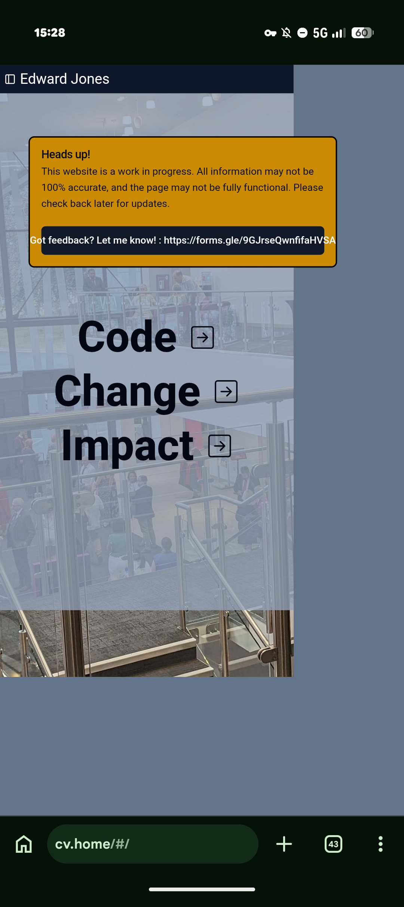

<!-- KAINBAIN AUTO-GENERATED REPORT -->
# Stage Report: Quick review

**Task:** Please make sure the mobile version works.   It currently looks rough and want it to behave nicer
**Stage Type:** `agent`
**Model:** `default`
**Duration:** 605.123s
**Status:** FAILED

### Summary of Changes
Execution failed: [Agent Review Rejection] The previous "Deploy dev" CI failure is unresolved: scripts/dev-server.sh (lines 13-29) only accepts --serve and -h|--help and exits with code 1 ("Unknown argument: start") when invoked with the "start" argument. Fix guidance: Update scripts/dev-server.sh to accept the "start" command (and optionally standard lifecycle subcommands like status/stop/restart if needed) so it builds and verifies the static bundle in ./docs cleanly and exits 0 without hanging CI or interfering with live app processes, then verify by running "./scripts/dev-server.sh start", "npm run lint", and "npm run test:unit".

### Execution Output
```
I reviewed the branch diff against `main`, [IMPLEMENTATION_PLAN.md](file:///home/[REDACTED]/.kainbain/runner-work/kb-f77c53b0-34d4-4159-b91a-92e40fc3fbf2/docs/tasks/f77c53b0-34d4-4159-b91a-92e40fc3fbf2/IMPLEMENTATION_PLAN.md), and [scripts/dev-server.sh](file:///home/[REDACTED]/.kainbain/runner-work/kb-f77c53b0-34d4-4159-b91a-92e40fc3fbf2/scripts/dev-server.sh), and verified `npm run lint` (0 errors) and `npm run test:unit` (6 test files, 31/31 tests passing); no files were modified in this review stage. The mobile responsiveness refactor across [src/App.jsx](file:///home/[REDACTED]/.kainbain/runner-work/kb-f77c53b0-34d4-4159-b91a-92e40fc3fbf2/src/App.jsx), [src/sidebar/sidebar.jsx](file:///home/[REDACTED]/.kainbain/runner-work/kb-f77c53b0-34d4-4159-b91a-92e40fc3fbf2/src/sidebar/sidebar.jsx), [src/components/PageSection.jsx](file:///home/[REDACTED]/.kainbain/runner-work/kb-f77c53b0-34d4-4159-b91a-92e40fc3fbf2/src/components/PageSection.jsx), [src/pages/projects/ProjectAccordionItem.jsx](file:///home/[REDACTED]/.kainbain/runner-work/kb-f77c53b0-34d4-4159-b91a-92e40fc3fbf2/src/pages/projects/ProjectAccordionItem.jsx), and the page components follows the plan cleanly and is easy to maintain. However, the previous "Deploy dev" CI failure (`Unknown argument: start`) remains unresolved because [scripts/dev-server.sh](file:///home/[REDACTED]/.kainbain/runner-work/kb-f77c53b0-34d4-4159-b91a-92e40fc3fbf2/scripts/dev-server.sh#L13-L29) still rejects the `start` subcommand with exit code 1.

KAINBAIN_VERDICT: FAIL
KAINBAIN_REASON: The previous "Deploy dev" CI failure is unresolved: scripts/dev-server.sh (lines 13-29) only accepts --serve and -h|--help and exits with code 1 ("Unknown argument: start") when invoked with the "start" argument.
KAINBAIN_FIX: Update scripts/dev-server.sh to accept the "start" command (and optionally standard lifecycle subcommands like status/stop/restart if needed) so it builds and verifies the static bundle in ./docs cleanly and exits 0 without hanging CI or interfering with live app processes, then verify by running "./scripts/dev-server.sh start", "npm run lint", and "npm run test:unit".

```

### Modified Files
- (No files modified / inspection only)

### Verification Status
- Stage execution failed with error: [Agent Review Rejection] The previous "Deploy dev" CI failure is unresolved: scripts/dev-server.sh (lines 13-29) only accepts --serve and -h|--help and exits with code 1 ("Unknown argument: start") when invoked with the "start" argument. Fix guidance: Update scripts/dev-server.sh to accept the "start" command (and optionally standard lifecycle subcommands like status/stop/restart if needed) so it builds and verifies the static bundle in ./docs cleanly and exits 0 without hanging CI or interfering with live app processes, then verify by running "./scripts/dev-server.sh start", "npm run lint", and "npm run test:unit".
- Triggered fallback routing.