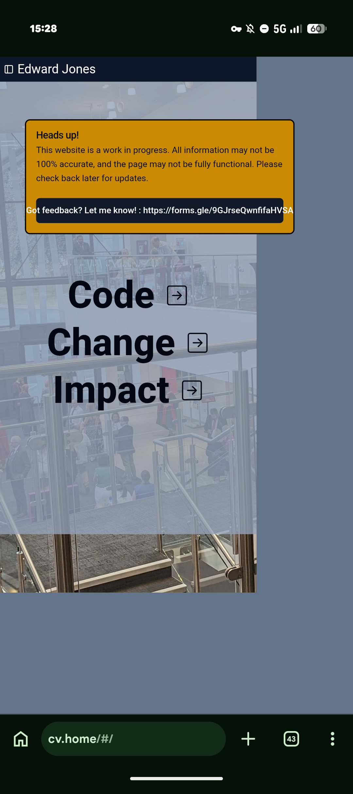

# Goal
Please make sure the mobile version works. 



It currently looks rough and want it to behave nicer

# History
- 2026-11-04T10:06:57.123Z: Created and placed in stage 'Idea'
- 2026-11-24T13:45:52.046Z: Task details edited
- 2026-11-24T15:28:32.337Z: Task details edited
- 2026-11-24T15:28:56.355Z: Task details edited
- 2026-11-24T15:29:13.813Z: Task details edited
- 2026-11-24T15:29:27.735Z: Task details edited
- 2026-11-24T15:29:32.987Z: Task details edited
- 2026-11-24T15:29:37.649Z: Task details edited
- 2026-11-24T15:29:39.816Z: Stage report generated: ./docs/tasks/f77c53b0-34d4-4159-b91a-92e40fc3fbf2/idea-20261124-152939.md
- 2026-11-24T15:29:39.817Z: Advanced to stage 'Plan'
- 2026-11-24T17:09:57.335Z: Runner server2-alpha stage stage-1791833613563-1: started
- 2026-11-24T17:10:06.298Z: Runner server2-alpha stage stage-1791833613563-1: prompted
- 2026-11-24T17:14:14.374Z: Runner server2-alpha stage stage-1791833613563-1: finished
- 2026-11-24T17:14:16.014Z: Runner server2-alpha interrupted execution af4ba3ee-2276-45d6-a022-6bfdfefdc7b8 — lease dropped, re-queues as interrupted.
- 2026-11-24T17:14:17.321Z: Auto-resumed after runner interrupt — prioritised in queue (runner server2-alpha)
- 2026-11-24T17:14:46.227Z: Runner server2-alpha stage stage-1791833613563-1: started
- 2026-11-24T17:14:47.451Z: Runner server2-alpha stage stage-1791833613563-1: prompted
- 2026-11-24T17:17:25.766Z: Runner server2-alpha stage stage-1791833613563-1: finished
- 2026-11-24T17:17:26.893Z: Runner server2-alpha interrupted execution c75018eb-59a5-4f93-bc7b-c1077510e5f0 — lease dropped, re-queues as interrupted.
- 2026-11-24T17:17:29.373Z: Auto-resumed after runner interrupt — prioritised in queue (runner server2-alpha)
- 2026-11-24T17:19:42.283Z: Runner server2-alpha stage stage-1791833613563-1: started
- 2026-11-24T17:19:43.501Z: Runner server2-alpha stage stage-1791833613563-1: prompted
- 2026-11-24T17:22:36.883Z: Runner server2-alpha stage stage-1791833613563-1: finished
- 2026-11-24T17:22:38.830Z: Runner server2-alpha interrupted execution fe974ebf-14f3-4206-b20f-1ba502d26f33 — lease dropped, re-queues as interrupted.
- 2026-11-24T17:22:41.649Z: Auto-resumed after runner interrupt — prioritised in queue (runner server2-alpha)
- 2026-11-24T17:26:35.212Z: Runner server2-alpha stage stage-1791833613563-1: started
- 2026-11-24T17:26:36.410Z: Runner server2-alpha stage stage-1791833613563-1: prompted
- 2026-11-24T17:29:34.803Z: Runner server2-alpha stage stage-1791833613563-1: finished
- 2026-11-24T17:29:36.310Z: Runner server2-alpha interrupted execution 8d2e5cb0-f985-4d24-aaf5-6328ca3ec63a — lease dropped, re-queues as interrupted.
- 2026-11-24T17:29:38.771Z: Auto-resumed after runner interrupt — prioritised in queue (runner server2-alpha)
- 2026-11-24T17:31:15.463Z: Runner server2-alpha stage stage-1791833613563-1: started
- 2026-11-24T17:31:16.582Z: Runner server2-alpha stage stage-1791833613563-1: prompted
- 2026-11-24T17:34:29.208Z: Runner server2-alpha stage stage-1791833613563-1: finished
- 2026-11-24T17:34:33.203Z: Runner completed execution f0235d83-6b69-4b2e-8769-0acde6674088 (runner server2-alpha, epoch 5, sha 109d82bfb3cdb8f54d3cc33f3a1b488284d3650e (unverified-remote), branch kb/f77c53b0-34d4-4159-b91a-92e40fc3fbf2, posture T0/T1:antigravity:antigravity::antigravity::gemini-4-neon-medium). Lease released. [attestation task=f77c53b0-34d4-4159-b91a-92e40fc3fbf2 stage=stage-1791833613563-1 config=sha256:4330b0ef38fd7901cede67ad096ae8f04dee5acc537d68a81c806bc5e87ffe38 commit=109d82bfb3cdb8f54d3cc33f3a1b488284d3650e]
- 2026-11-24T17:34:33.203Z: Agent stage completed: Plan (via Runner server2-alpha)
- 2026-11-24T17:34:33.207Z: Advanced to stage 'In Progress'
- 2026-11-24T17:39:01.210Z: Runner server2-alpha stage stage-1791833613563-5: started
- 2026-11-24T17:39:02.627Z: Runner server2-alpha stage stage-1791833613563-5: prompted
- 2026-11-24T17:46:49.583Z: Runner server2-alpha stage stage-1791833613563-5: finished
- 2026-11-24T17:46:58.903Z: Runner completed execution b87e59d6-1cd6-46a5-b7c2-7a12a64a0778 (runner server2-alpha, epoch 6, sha 5a05fd5ed13ab997be5fae1c707e8998e70b4d5b (unverified-remote), branch kb/f77c53b0-34d4-4159-b91a-92e40fc3fbf2, posture T0/T1:antigravity:antigravity::antigravity::gemini-4-neon-medium). Lease released. [attestation task=f77c53b0-34d4-4159-b91a-92e40fc3fbf2 stage=stage-1791833613563-5 config=sha256:79c63c681c8cc87103715eb899079d840537349c430ab82aad2268bc31631386 commit=5a05fd5ed13ab997be5fae1c707e8998e70b4d5b]
- 2026-11-24T17:46:58.904Z: Agent stage completed: In Progress (via Runner server2-alpha)
- 2026-11-24T17:46:58.907Z: Advanced to stage 'Cleaning pass'
- 2026-11-24T17:55:09.978Z: Runner server2-alpha stage stage-1791833613563-8: started
- 2026-11-24T17:55:11.355Z: Runner server2-alpha stage stage-1791833613563-8: prompted
- 2026-11-24T18:02:11.514Z: Runner server2-alpha stage stage-1791833613563-8: finished
- 2026-11-24T18:02:14.826Z: Runner completed execution 2b1934fc-4a4e-4936-9065-3bd7722c82e3 (runner server2-alpha, epoch 7, sha d1eb307d8dd8f84587a4b9305bdc65bb62b05444 (unverified-remote), branch kb/f77c53b0-34d4-4159-b91a-92e40fc3fbf2, posture T0/T1:antigravity:antigravity::antigravity::gemini-4-neon-medium). Lease released. [attestation task=f77c53b0-34d4-4159-b91a-92e40fc3fbf2 stage=stage-1791833613563-8 config=sha256:62e3b8fb1d534351ea934b4fc7713dbb82ec97f92da0279c5412cf5e1e1b5232 commit=d1eb307d8dd8f84587a4b9305bdc65bb62b05444]
- 2026-11-24T18:02:14.826Z: Agent stage completed: Cleaning pass (via Runner server2-alpha)
- 2026-11-24T18:02:14.830Z: Advanced to stage 'Quick review'
- 2026-11-24T18:21:26.225Z: Runner server2-alpha stage stage-1791833613563-7: started
- 2026-11-24T18:21:27.684Z: Runner server2-alpha stage stage-1791833613563-7: prompted
- 2026-11-24T18:23:10.497Z: Runner server2-alpha stage stage-1791833613563-7: finished
- 2026-11-24T18:23:12.164Z: Runner completed execution 2cf3a2f8-6ec2-40fc-ab37-8c702e90d6d4 (runner server2-alpha, epoch 8, sha d1eb307d8dd8f84587a4b9305bdc65bb62b05444 (unverified-remote), branch kb/f77c53b0-34d4-4159-b91a-92e40fc3fbf2, posture T0/T1:antigravity:antigravity::antigravity::gemini-4-neon-medium). Lease released. [attestation task=f77c53b0-34d4-4159-b91a-92e40fc3fbf2 stage=stage-1791833613563-7 config=sha256:0ebcc928e5103a453f67f0dcd852ec5d5696bbf07964c90d215543d0aa0350f2 commit=none]
- 2026-11-24T18:23:12.165Z: Agent stage completed: Quick review (via Runner server2-alpha)
- 2026-11-24T18:23:12.168Z: Advanced to stage 'Deploy dev'
- 2026-11-24T18:23:59.771Z: Runner server2-alpha stage stage-1792093968770: started
- 2026-11-24T18:24:00.983Z: Runner server2-alpha stage stage-1792093968770: prompted
- 2026-11-24T18:24:01.004Z: Runner server2-alpha stage stage-1792093968770: finished
- 2026-11-24T18:24:01.094Z: Runner completed execution 410e4153-89d3-4420-85a5-899c4d22f15d (runner server2-alpha, epoch 9, sha d1eb307d8dd8f84587a4b9305bdc65bb62b05444 (unverified-remote), branch kb/f77c53b0-34d4-4159-b91a-92e40fc3fbf2, posture T0/T1:pi). Lease released. [attestation task=f77c53b0-34d4-4159-b91a-92e40fc3fbf2 stage=stage-1792093968770 config=sha256:31da02ab6dd10e04867442856fa5e47529114b910d5721df61fed7da91a7d694 commit=none]
- 2026-11-24T18:24:01.097Z: Stage failed in 'Deploy dev': CI command failed with exit code 127
- 2026-11-24T18:24:01.099Z: Stage report generated: ./docs/tasks/f77c53b0-34d4-4159-b91a-92e40fc3fbf2/deploy-dev-failure-20261124-182401.md
- 2026-11-24T18:24:01.101Z: Failed back to stage 'Quick review'
- 2026-11-24T18:24:01.417Z: Runner server2-alpha stage stage-1791833613563-7: started
- 2026-11-24T18:24:02.622Z: Runner server2-alpha stage stage-1791833613563-7: prompted
- 2026-11-24T18:26:42.678Z: Runner server2-alpha stage stage-1791833613563-7: finished
- 2026-11-24T18:26:45.466Z: Runner completed execution 31779876-5779-4864-acac-854e07db96d1 (runner server2-alpha, epoch 10, sha d1eb307d8dd8f84587a4b9305bdc65bb62b05444 (unverified-remote), branch kb/f77c53b0-34d4-4159-b91a-92e40fc3fbf2, posture T0/T1:antigravity:antigravity::antigravity::gemini-4-neon-medium). Lease released. [attestation task=f77c53b0-34d4-4159-b91a-92e40fc3fbf2 stage=stage-1791833613563-7 config=sha256:0ebcc928e5103a453f67f0dcd852ec5d5696bbf07964c90d215543d0aa0350f2 commit=none]
- 2026-11-24T18:26:45.467Z: Stage failed in 'Quick review': [Agent Review Rejection] The previous "Deploy dev" CI stage failure is unresolved: the repository has no ./scripts/dev-server.sh file (or scripts/ directory), causing exit code 127 when "Deploy dev" runs. (All mobile UI changes, lint, 30 unit tests, and Vite production build otherwise pass review.) Fix guidance: Add an executable scripts/dev-server.sh appropriate for the dev deployment environment (without interfering with live operations) and commit it to the branch, or update the "Deploy dev" CI stage command to use an existing script in package.json (such as npm run build / npm run preview).
- 2026-11-24T18:26:45.469Z: Stage report generated: ./docs/tasks/f77c53b0-34d4-4159-b91a-92e40fc3fbf2/quick-review-failure-20261124-182645.md
- 2026-11-24T18:26:45.470Z: Failed back to stage 'In Progress'
- 2026-11-24T18:27:18.811Z: Runner server2-alpha stage stage-1791833613563-5: started
- 2026-11-24T18:27:20.238Z: Runner server2-alpha stage stage-1791833613563-5: prompted
- 2026-11-24T18:30:44.250Z: Runner server2-alpha stage stage-1791833613563-5: finished
- 2026-11-24T18:30:52.751Z: Runner server2-alpha interrupted execution 5c0da6e3-c319-4e02-ab4b-92f7fbb7100d — lease dropped, re-queues as interrupted.
- 2026-11-24T18:30:54.994Z: Auto-resumed after runner interrupt — prioritised in queue (runner server2-alpha)
- 2026-11-24T18:33:51.398Z: Runner server2-alpha stage stage-1791833613563-5: started
- 2026-11-24T18:33:52.585Z: Runner server2-alpha stage stage-1791833613563-5: prompted
- 2026-11-24T18:37:08.977Z: Runner server2-alpha stage stage-1791833613563-5: finished
- 2026-11-24T18:37:12.037Z: Runner completed execution a345e628-b953-4bd1-9ea9-1dc2bf9d7a99 (runner server2-alpha, epoch 12, sha b87039d4b4ae823dcf53c485f8682ab34f5f77ec (unverified-remote), branch kb/f77c53b0-34d4-4159-b91a-92e40fc3fbf2, posture T0/T1:antigravity:antigravity::antigravity::gemini-4-neon-medium). Lease released. [attestation task=f77c53b0-34d4-4159-b91a-92e40fc3fbf2 stage=stage-1791833613563-5 config=sha256:79c63c681c8cc87103715eb899079d840537349c430ab82aad2268bc31631386 commit=b87039d4b4ae823dcf53c485f8682ab34f5f77ec]
- 2026-11-24T18:37:12.037Z: Agent stage completed: In Progress (via Runner server2-alpha)
- 2026-11-24T18:37:12.041Z: Advanced to stage 'Cleaning pass'
- 2026-11-24T18:37:12.320Z: Runner server2-alpha stage stage-1791833613563-8: started
- 2026-11-24T18:37:13.490Z: Runner server2-alpha stage stage-1791833613563-8: prompted
- 2026-11-24T18:41:13.937Z: Runner server2-alpha stage stage-1791833613563-8: finished
- 2026-11-24T18:41:17.954Z: Runner completed execution f82ae803-bedf-49c8-848a-3e8c1caea113 (runner server2-alpha, epoch 13, sha 9627dbfefd9f023a6b910aac0bbff299c51e9b80 (unverified-remote), branch kb/f77c53b0-34d4-4159-b91a-92e40fc3fbf2, posture T0/T1:antigravity:antigravity::antigravity::gemini-4-neon-medium). Lease released. [attestation task=f77c53b0-34d4-4159-b91a-92e40fc3fbf2 stage=stage-1791833613563-8 config=sha256:62e3b8fb1d534351ea934b4fc7713dbb82ec97f92da0279c5412cf5e1e1b5232 commit=9627dbfefd9f023a6b910aac0bbff299c51e9b80]
- 2026-11-24T18:41:17.955Z: Agent stage completed: Cleaning pass (via Runner server2-alpha)
- 2026-11-24T18:41:17.958Z: Advanced to stage 'Quick review'
- 2026-11-24T18:41:18.255Z: Runner server2-alpha stage stage-1791833613563-7: started
- 2026-11-24T18:41:19.372Z: Runner server2-alpha stage stage-1791833613563-7: prompted
- 2026-11-24T18:43:43.139Z: Runner server2-alpha stage stage-1791833613563-7: finished
- 2026-11-24T18:43:45.014Z: Runner completed execution 58fc4a5f-99ae-4f75-8aab-0eba64f8d27a (runner server2-alpha, epoch 14, sha 9627dbfefd9f023a6b910aac0bbff299c51e9b80 (unverified-remote), branch kb/f77c53b0-34d4-4159-b91a-92e40fc3fbf2, posture T0/T1:antigravity:antigravity::antigravity::gemini-4-neon-medium). Lease released. [attestation task=f77c53b0-34d4-4159-b91a-92e40fc3fbf2 stage=stage-1791833613563-7 config=sha256:0ebcc928e5103a453f67f0dcd852ec5d5696bbf07964c90d215543d0aa0350f2 commit=none]
- 2026-11-24T18:43:45.014Z: Agent stage completed: Quick review (via Runner server2-alpha)
- 2026-11-24T18:43:45.018Z: Advanced to stage 'Deploy dev'
- 2026-11-24T18:43:45.292Z: Runner server2-alpha stage stage-1792093968770: started
- 2026-11-24T18:43:46.480Z: Runner server2-alpha stage stage-1792093968770: prompted
- 2026-11-24T18:43:46.520Z: Runner server2-alpha stage stage-1792093968770: finished
- 2026-11-24T18:43:46.556Z: Runner completed execution 2686c04d-1b6e-427f-ad7a-3ae0ef9e0ec1 (runner server2-alpha, epoch 15, sha 9627dbfefd9f023a6b910aac0bbff299c51e9b80 (unverified-remote), branch kb/f77c53b0-34d4-4159-b91a-92e40fc3fbf2, posture T0/T1:pi). Lease released. [attestation task=f77c53b0-34d4-4159-b91a-92e40fc3fbf2 stage=stage-1792093968770 config=sha256:31da02ab6dd10e04867442856fa5e47529114b910d5721df61fed7da91a7d694 commit=none]
- 2026-11-24T18:43:46.558Z: Stage failed in 'Deploy dev': CI command failed with exit code 1
- 2026-11-24T18:43:46.560Z: Stage report generated: ./docs/tasks/f77c53b0-34d4-4159-b91a-92e40fc3fbf2/deploy-dev-failure-20261124-184346.md
- 2026-11-24T18:43:46.562Z: Failed back to stage 'Quick review'
- 2026-11-24T18:51:13.219Z: Runner server2-alpha stage stage-1791833613563-7: started
- 2026-11-24T18:51:14.331Z: Runner server2-alpha stage stage-1791833613563-7: prompted
- 2026-11-24T18:53:50.189Z: Runner server2-alpha stage stage-1791833613563-7: finished
- 2026-11-24T18:53:51.682Z: Runner completed execution c7bc68a7-33b4-4cff-a4c1-6ff544bc3655 (runner server2-alpha, epoch 16, sha 9627dbfefd9f023a6b910aac0bbff299c51e9b80 (unverified-remote), branch kb/f77c53b0-34d4-4159-b91a-92e40fc3fbf2, posture T0/T1:antigravity:antigravity::antigravity::gemini-4-neon-medium). Lease released. [attestation task=f77c53b0-34d4-4159-b91a-92e40fc3fbf2 stage=stage-1791833613563-7 config=sha256:0ebcc928e5103a453f67f0dcd852ec5d5696bbf07964c90d215543d0aa0350f2 commit=none]
- 2026-11-24T18:53:51.683Z: Stage failed in 'Quick review': [Agent Review Rejection] The previous "Deploy dev" CI failure is unresolved: scripts/dev-server.sh (lines 13-29) only accepts --serve and -h|--help and exits with code 1 ("Unknown argument: start") when invoked with the "start" argument. Fix guidance: Update scripts/dev-server.sh to accept the "start" command (and optionally standard lifecycle subcommands like status/stop/restart if needed) so it builds and verifies the static bundle in ./docs cleanly and exits 0 without hanging CI or interfering with live app processes, then verify by running "./scripts/dev-server.sh start", "npm run lint", and "npm run test:unit".
- 2026-11-24T18:53:51.685Z: Stage report generated: ./docs/tasks/f77c53b0-34d4-4159-b91a-92e40fc3fbf2/quick-review-failure-20261124-185351.md
- 2026-11-24T18:53:51.687Z: Failed back to stage 'In Progress'
- 2026-11-24T18:53:52.133Z: Runner server2-alpha stage stage-1791833613563-5: started
- 2026-11-24T18:53:53.366Z: Runner server2-alpha stage stage-1791833613563-5: prompted
- 2026-11-24T18:55:41.399Z: Runner server2-alpha stage stage-1791833613563-5: finished
- 2026-11-24T18:55:44.881Z: Runner completed execution 1578506b-277b-48b1-97e4-62e6375572af (runner server2-alpha, epoch 17, sha 22781991892e6c73fa39a004e9dafae395cde2ac (unverified-remote), branch kb/f77c53b0-34d4-4159-b91a-92e40fc3fbf2, posture T0/T1:antigravity:antigravity::antigravity::gemini-4-neon-medium). Lease released. [attestation task=f77c53b0-34d4-4159-b91a-92e40fc3fbf2 stage=stage-1791833613563-5 config=sha256:79c63c681c8cc87103715eb899079d840537349c430ab82aad2268bc31631386 commit=22781991892e6c73fa39a004e9dafae395cde2ac]
- 2026-11-24T18:55:44.882Z: Agent stage completed: In Progress (via Runner server2-alpha)
- 2026-11-24T18:55:44.885Z: Advanced to stage 'Cleaning pass'
- 2026-11-24T18:55:48.019Z: Runner server2-alpha stage stage-1791833613563-8: started
- 2026-11-24T18:55:49.079Z: Runner server2-alpha stage stage-1791833613563-8: prompted
- 2026-11-24T18:58:42.141Z: Runner server2-alpha stage stage-1791833613563-8: finished
- 2026-11-24T18:58:45.318Z: Runner completed execution 2b29643d-604d-409d-9f27-fd81fbc3a526 (runner server2-alpha, epoch 18, sha d0c17684ee864b0dda8388c10274941f52c52403 (unverified-remote), branch kb/f77c53b0-34d4-4159-b91a-92e40fc3fbf2, posture T0/T1:antigravity:antigravity::antigravity::gemini-4-neon-medium). Lease released. [attestation task=f77c53b0-34d4-4159-b91a-92e40fc3fbf2 stage=stage-1791833613563-8 config=sha256:62e3b8fb1d534351ea934b4fc7713dbb82ec97f92da0279c5412cf5e1e1b5232 commit=d0c17684ee864b0dda8388c10274941f52c52403]
- 2026-11-24T18:58:45.319Z: Agent stage completed: Cleaning pass (via Runner server2-alpha)
- 2026-11-24T18:58:45.322Z: Advanced to stage 'Quick review'
- 2026-11-24T18:58:45.687Z: Runner server2-alpha stage stage-1791833613563-7: started
- 2026-11-24T18:58:46.963Z: Runner server2-alpha stage stage-1791833613563-7: prompted
- 2026-11-24T19:01:07.758Z: Runner server2-alpha stage stage-1791833613563-7: finished
- 2026-11-24T19:01:09.557Z: Runner completed execution 6d44f7b6-e952-4ca3-b755-625ef202855a (runner server2-alpha, epoch 19, sha d0c17684ee864b0dda8388c10274941f52c52403 (unverified-remote), branch kb/f77c53b0-34d4-4159-b91a-92e40fc3fbf2, posture T0/T1:antigravity:antigravity::antigravity::gemini-4-neon-medium). Lease released. [attestation task=f77c53b0-34d4-4159-b91a-92e40fc3fbf2 stage=stage-1791833613563-7 config=sha256:0ebcc928e5103a453f67f0dcd852ec5d5696bbf07964c90d215543d0aa0350f2 commit=none]
- 2026-11-24T19:01:09.557Z: Agent stage completed: Quick review (via Runner server2-alpha)
- 2026-11-24T19:01:09.561Z: Advanced to stage 'Deploy dev'
- 2026-11-24T19:01:09.871Z: Runner server2-alpha stage stage-1792093968770: started
- 2026-11-24T19:01:10.931Z: Runner server2-alpha stage stage-1792093968770: prompted
- 2026-11-24T19:01:15.745Z: Runner server2-alpha stage stage-1792093968770: finished
- 2026-11-24T19:01:15.951Z: Runner completed execution cf44850a-880f-49c9-bb54-a865e3f7edb3 (runner server2-alpha, epoch 20, sha d0c17684ee864b0dda8388c10274941f52c52403 (unverified-remote), branch kb/f77c53b0-34d4-4159-b91a-92e40fc3fbf2, posture T0/T1:pi). Lease released. [attestation task=f77c53b0-34d4-4159-b91a-92e40fc3fbf2 stage=stage-1792093968770 config=sha256:31da02ab6dd10e04867442856fa5e47529114b910d5721df61fed7da91a7d694 commit=none]
- 2026-11-24T19:01:15.952Z: Agent stage completed: Deploy dev (via Runner server2-alpha)
- 2026-11-24T19:01:15.955Z: Advanced to stage 'Final review'
- 2026-11-24T20:56:00.745Z: Stage report generated: ./docs/tasks/f77c53b0-34d4-4159-b91a-92e40fc3fbf2/final-review-20261124-205600.md
- 2026-11-24T20:56:00.752Z: Advanced to stage 'Merge'
- 2026-11-24T20:56:00.862Z: Created task-branch ref 'kb/f77c53b0-34d4-4159-b91a-92e40fc3fbf2' from 'main' without checkout (human checkpoint 'Final review'; leaving 93 uncommitted paths in the tree for the next work stage)
- 2026-11-24T20:56:03.385Z: Runner local-alpha stage stage-1791833613563-11: started
- 2026-11-24T20:56:14.677Z: Runner local-alpha stage stage-1791833613563-11: finished
- 2026-11-24T20:56:14.681Z: Runner local-alpha verified push SHA 7478e01 against the remote.
- 2026-11-24T20:56:14.684Z: Runner completed execution 152b2e2f-fcd8-4539-a949-5f3ac41ed831 (runner local-alpha, epoch 21, sha 7478e01ea9a9d6ab6929a77ee09c3ede42676ac6 (unverified-remote), branch kb/f77c53b0-34d4-4159-b91a-92e40fc3fbf2, posture T0/T1:integration). Lease released. [attestation task=f77c53b0-34d4-4159-b91a-92e40fc3fbf2 stage=stage-1791833613563-11 config=sha256:31da02ab6dd10e04867442856fa5e47529114b910d5721df61fed7da91a7d694 commit=7478e01ea9a9d6ab6929a77ee09c3ede42676ac6]
- 2026-11-24T20:56:14.684Z: Agent stage completed: Merge (via Runner local-alpha)
- 2026-11-24T20:56:14.688Z: Completed

# Timeline
- 2026-11-24T15:29:39.817Z: Plan | Advanced | 1747362.694s | +0 -0
- 2026-11-24T17:14:17.321Z: Plan | Resumed | 0m
- 2026-11-24T17:17:29.373Z: Plan | Resumed | 0m
- 2026-11-24T17:22:41.649Z: Plan | Resumed | 0m
- 2026-11-24T17:29:38.771Z: Plan | Resumed | 0m
- 2026-11-24T17:34:33.207Z: In Progress | Advanced | 294.436s | +0 -0
- 2026-11-24T17:46:58.907Z: Cleaning pass | Advanced | 745.7s | +0 -0
- 2026-11-24T18:02:14.830Z: Quick review | Advanced | 915.923s | +0 -0
- 2026-11-24T18:23:12.168Z: Deploy dev | Advanced | 1257.338s | +0 -0
- 2026-11-24T18:24:01.098Z: Deploy dev | Failed | 48.929s | +0 -0
- 2026-11-24T18:24:01.101Z: Quick review | Moved | 48.933s | +0 -0
- 2026-11-24T18:26:45.468Z: Quick review | Failed | 164.367s | +0 -0
- 2026-11-24T18:26:45.470Z: In Progress | Moved | 164.369s | +0 -0
- 2026-11-24T18:30:54.995Z: In Progress | Resumed | 0m
- 2026-11-24T18:37:12.041Z: Cleaning pass | Advanced | 377.047s | +0 -0
- 2026-11-24T18:41:17.958Z: Quick review | Advanced | 245.917s | +0 -0
- 2026-11-24T18:43:45.018Z: Deploy dev | Advanced | 147.06s | +0 -0
- 2026-11-24T18:43:46.560Z: Deploy dev | Failed | 1.542s | +0 -0
- 2026-11-24T18:43:46.562Z: Quick review | Moved | 1.544s | +0 -0
- 2026-11-24T18:53:51.685Z: Quick review | Failed | 605.123s | +0 -0
- 2026-11-24T18:53:51.687Z: In Progress | Moved | 605.124s | +0 -0
- 2026-11-24T18:55:44.885Z: Cleaning pass | Advanced | 113.198s | +0 -0
- 2026-11-24T18:58:45.322Z: Quick review | Advanced | 180.437s | +0 -0
- 2026-11-24T19:01:09.561Z: Deploy dev | Advanced | 144.239s | +0 -0
- 2026-11-24T19:01:15.955Z: Final review | Advanced | 6.394s | +0 -0
- 2026-11-24T20:56:00.752Z: Merge | Advanced | 6884.797s
- 2026-11-24T20:56:14.688Z: Merge | Completed | 13.936s

# Log Entries
```json
[{"id":"log-9197","ts":"2026-11-24T15:29:39.817Z","feed":"main","feeds":["main"],"kind":"system","turn":null,"text":"[INFO] Advanced from stage 'Idea' to stage 'Plan'","meta":{"source":"process-log"}},{"id":1,"ts":"2026-11-24T17:10:11.718Z","feed":"main","feeds":["main"],"kind":"system","turn":1,"text":"[AGY] run open: model=gemini-4-neon-medium sandbox=off approvals=auto permission_mode=always-proceed conversation=aa2ed9fa","meta":{"source":"runner-structured","runnerId":"server2-alpha","executionId":"af4ba3ee-2276-45d6-a022-6bfdfefdc7b8","seq":0},"fidelity":"synthesized","seq":1},{"id":2,"ts":"2026-11-24T17:10:11.718Z","feed":"main","feeds":["main"],"kind":"system","turn":1,"text":"[AGY] step (step ?)","meta":{"source":"runner-structured","runnerId":"server2-alpha","executionId":"af4ba3ee-2276-45d6-a022-6bfdfefdc7b8","seq":0},"fidelity":"synthesized","seq":2},{"id":3,"ts":"2026-11-24T17:14:13.852Z","feed":"telemetry","feeds":["telemetry"],"kind":"telemetry","turn":1,"text":"[USAGE] tokens=68034/14967/83001","meta":{"model":null,"source":"runner-structured","runnerId":"server2-alpha","executionId":"af4ba3ee-2276-45d6-a022-6bfdfefdc7b8","seq":1},"fidelity":"synthesized","seq":3,"usage":{"input_tokens":68034,"output_tokens":14967,"thinking_tokens":6332,"cache_read_tokens":358114,"total_tokens":83001}},{"id":4,"ts":"2026-11-24T17:14:13.852Z","feed":"main","feeds":["main"],"kind":"system","turn":1,"text":"[AGY] run done: status=SUCCESS in 242.5s · 83001 tokens","meta":{"source":"runner-structured","runnerId":"server2-alpha","executionId":"af4ba3ee-2276-45d6-a022-6bfdfefdc7b8","seq":1},"fidelity":"synthesized","seq":4},{"id":1,"ts":"2026-11-24T17:14:53.697Z","feed":"main","feeds":["main"],"kind":"system","turn":1,"text":"[AGY] run open: model=gemini-4-neon-medium sandbox=off approvals=auto permission_mode=always-proceed conversation=3e25b9fd","meta":{"source":"runner-structured","runnerId":"server2-alpha","executionId":"c75018eb-59a5-4f93-bc7b-c1077510e5f0","seq":0},"fidelity":"synthesized","seq":1},{"id":2,"ts":"2026-11-24T17:14:53.697Z","feed":"main","feeds":["main"],"kind":"system","turn":1,"text":"[AGY] step (step ?)","meta":{"source":"runner-structured","runnerId":"server2-alpha","executionId":"c75018eb-59a5-4f93-bc7b-c1077510e5f0","seq":0},"fidelity":"synthesized","seq":2},{"id":3,"ts":"2026-11-24T17:17:25.357Z","feed":"telemetry","feeds":["telemetry"],"kind":"telemetry","turn":1,"text":"[USAGE] tokens=60977/8218/69195","meta":{"model":null,"source":"runner-structured","runnerId":"server2-alpha","executionId":"c75018eb-59a5-4f93-bc7b-c1077510e5f0","seq":1},"fidelity":"synthesized","seq":3,"usage":{"input_tokens":60977,"output_tokens":8218,"thinking_tokens":2821,"cache_read_tokens":359009,"total_tokens":69195}},{"id":4,"ts":"2026-11-24T17:17:25.357Z","feed":"main","feeds":["main"],"kind":"system","turn":1,"text":"[AGY] run done: status=SUCCESS in 152.1s · 69195 tokens","meta":{"source":"runner-structured","runnerId":"server2-alpha","executionId":"c75018eb-59a5-4f93-bc7b-c1077510e5f0","seq":1},"fidelity":"synthesized","seq":4},{"id":1,"ts":"2026-11-24T17:19:49.552Z","feed":"main","feeds":["main"],"kind":"system","turn":1,"text":"[AGY] run open: model=gemini-4-neon-medium sandbox=off approvals=auto permission_mode=always-proceed conversation=161b9cbf","meta":{"source":"runner-structured","runnerId":"server2-alpha","executionId":"fe974ebf-14f3-4206-b20f-1ba502d26f33","seq":0},"fidelity":"synthesized","seq":1},{"id":2,"ts":"2026-11-24T17:19:49.552Z","feed":"main","feeds":["main"],"kind":"system","turn":1,"text":"[AGY] step (step ?)","meta":{"source":"runner-structured","runnerId":"server2-alpha","executionId":"fe974ebf-14f3-4206-b20f-1ba502d26f33","seq":0},"fidelity":"synthesized","seq":2},{"id":3,"ts":"2026-11-24T17:22:36.340Z","feed":"telemetry","feeds":["telemetry"],"kind":"telemetry","turn":1,"text":"[USAGE] tokens=57584/5976/63560","meta":{"model":null,"source":"runner-structured","runnerId":"server2-alpha","executionId":"fe974ebf-14f3-4206-b20f-1ba502d26f33","seq":1},"fidelity":"synthesized","seq":3,"usage":{"input_tokens":57584,"output_tokens":5976,"thinking_tokens":1866,"cache_read_tokens":277058,"total_tokens":63560}},{"id":4,"ts":"2026-11-24T17:22:36.340Z","feed":"main","feeds":["main"],"kind":"system","turn":1,"text":"[AGY] run done: status=SUCCESS in 167.2s · 63560 tokens","meta":{"source":"runner-structured","runnerId":"server2-alpha","executionId":"fe974ebf-14f3-4206-b20f-1ba502d26f33","seq":1},"fidelity":"synthesized","seq":4},{"id":1,"ts":"2026-11-24T17:26:41.933Z","feed":"main","feeds":["main"],"kind":"system","turn":1,"text":"[AGY] run open: model=gemini-4-neon-medium sandbox=off approvals=auto permission_mode=always-proceed conversation=eeedbc49","meta":{"source":"runner-structured","runnerId":"server2-alpha","executionId":"8d2e5cb0-f985-4d24-aaf5-6328ca3ec63a","seq":0},"fidelity":"synthesized","seq":1},{"id":2,"ts":"2026-11-24T17:26:41.934Z","feed":"main","feeds":["main"],"kind":"system","turn":1,"text":"[AGY] step (step ?)","meta":{"source":"runner-structured","runnerId":"server2-alpha","executionId":"8d2e5cb0-f985-4d24-aaf5-6328ca3ec63a","seq":0},"fidelity":"synthesized","seq":2},{"id":3,"ts":"2026-11-24T17:29:34.073Z","feed":"telemetry","feeds":["telemetry"],"kind":"telemetry","turn":1,"text":"[USAGE] tokens=66503/6508/73011","meta":{"model":null,"source":"runner-structured","runnerId":"server2-alpha","executionId":"8d2e5cb0-f985-4d24-aaf5-6328ca3ec63a","seq":1},"fidelity":"synthesized","seq":3,"usage":{"input_tokens":66503,"output_tokens":6508,"thinking_tokens":2210,"cache_read_tokens":313985,"total_tokens":73011}},{"id":4,"ts":"2026-11-24T17:29:34.073Z","feed":"main","feeds":["main"],"kind":"system","turn":1,"text":"[AGY] run done: status=SUCCESS in 172.3s · 73011 tokens","meta":{"source":"runner-structured","runnerId":"server2-alpha","executionId":"8d2e5cb0-f985-4d24-aaf5-6328ca3ec63a","seq":1},"fidelity":"synthesized","seq":4},{"id":1,"ts":"2026-11-24T17:31:21.712Z","feed":"main","feeds":["main"],"kind":"system","turn":1,"text":"[AGY] run open: model=gemini-4-neon-medium sandbox=off approvals=auto permission_mode=always-proceed conversation=0a9a8d0e","meta":{"source":"runner-structured","runnerId":"server2-alpha","executionId":"f0235d83-6b69-4b2e-8769-0acde6674088","seq":0},"fidelity":"synthesized","seq":1},{"id":2,"ts":"2026-11-24T17:31:21.713Z","feed":"main","feeds":["main"],"kind":"system","turn":1,"text":"[AGY] step (step ?)","meta":{"source":"runner-structured","runnerId":"server2-alpha","executionId":"f0235d83-6b69-4b2e-8769-0acde6674088","seq":0},"fidelity":"synthesized","seq":2},{"id":3,"ts":"2026-11-24T17:34:28.801Z","feed":"telemetry","feeds":["telemetry"],"kind":"telemetry","turn":1,"text":"[USAGE] tokens=68360/9224/77584","meta":{"model":null,"source":"runner-structured","runnerId":"server2-alpha","executionId":"f0235d83-6b69-4b2e-8769-0acde6674088","seq":1},"fidelity":"synthesized","seq":3,"usage":{"input_tokens":68360,"output_tokens":9224,"thinking_tokens":4042,"cache_read_tokens":324420,"total_tokens":77584}},{"id":4,"ts":"2026-11-24T17:34:28.801Z","feed":"main","feeds":["main"],"kind":"system","turn":1,"text":"[AGY] run done: status=SUCCESS in 187.3s · 77584 tokens","meta":{"source":"runner-structured","runnerId":"server2-alpha","executionId":"f0235d83-6b69-4b2e-8769-0acde6674088","seq":1},"fidelity":"synthesized","seq":4},{"id":"log-9512","ts":"2026-11-24T17:34:32.793Z","feed":"main","feeds":["main"],"kind":"runner","turn":null,"text":"[runner server2-alpha] stage output: I audited the full frontend codebase (`src/`, `index.html`, `vite.config.js`, `eslint.config.js`, and `package.json`) and updated [IMPLEMENTATION_PLAN.md](file:///home/[REDACTED]/.kainbain/runner-work/kb-f77c53b0-34d4-4159-b91a-92e40fc3fbf2/docs/tasks/f77c53b0-34d4-4159-b91a-92e40fc3fbf2/IMPLEMENTATION_PLAN.md) with a step-by-step mobile responsiveness and UX plan. The plan follows \"make the change easy, then make the change\": starting with baseline audits and Vitest test harness setup, extracting shared responsive primitives (`useHashScroll`, `PageSection`, `ProjectAccordionItem`) and fixing global CSS/UI primitives, then applying targeted mobile improvements to the app shell, sidebar drawer, and all pages. It also includes automated unit/component testing, headless overflow/visual verification, `docs/tasks/` build-safety precautions, documentation updates, and a clear acceptance-criteria checklist.","meta":{"source":"process-log","runnerId":"server2-alpha","executionId":"f0235d83-6b69-4b2e-8769-0acde6674088","seq":0}},{"id":"log-9513","ts":"2026-11-24T17:34:32.998Z","feed":"main","feeds":["main"],"kind":"runner","turn":null,"text":"[runner server2-alpha] KAINBAIN_VERDICT: PASS","meta":{"source":"process-log","runnerId":"server2-alpha","executionId":"f0235d83-6b69-4b2e-8769-0acde6674088","seq":1}},{"id":"log-9514","ts":"2026-11-24T17:34:33.207Z","feed":"main","feeds":["main"],"kind":"system","turn":null,"text":"[INFO] Advanced from stage 'Plan' to stage 'In Progress'","meta":{"source":"process-log"}},{"id":1,"ts":"2026-11-24T17:39:09.288Z","feed":"main","feeds":["main"],"kind":"system","turn":1,"text":"[AGY] run open: model=gemini-4-neon-medium sandbox=off approvals=auto permission_mode=always-proceed conversation=42d3bb64","meta":{"source":"runner-structured","runnerId":"server2-alpha","executionId":"b87e59d6-1cd6-46a5-b7c2-7a12a64a0778","seq":0},"fidelity":"synthesized","seq":1},{"id":2,"ts":"2026-11-24T17:39:09.288Z","feed":"main","feeds":["main"],"kind":"system","turn":1,"text":"[AGY] step (step ?)","meta":{"source":"runner-structured","runnerId":"server2-alpha","executionId":"b87e59d6-1cd6-46a5-b7c2-7a12a64a0778","seq":0},"fidelity":"synthesized","seq":2},{"id":3,"ts":"2026-11-24T17:46:49.174Z","feed":"telemetry","feeds":["telemetry"],"kind":"telemetry","turn":1,"text":"[USAGE] tokens=114288/35384/149672","meta":{"model":null,"source":"runner-structured","runnerId":"server2-alpha","executionId":"b87e59d6-1cd6-46a5-b7c2-7a12a64a0778","seq":1},"fidelity":"synthesized","seq":3,"usage":{"input_tokens":114288,"output_tokens":35384,"thinking_tokens":7364,"cache_read_tokens":1081112,"total_tokens":149672}},{"id":4,"ts":"2026-11-24T17:46:49.174Z","feed":"main","feeds":["main"],"kind":"system","turn":1,"text":"[AGY] run done: status=SUCCESS in 460.3s · 149672 tokens","meta":{"source":"runner-structured","runnerId":"server2-alpha","executionId":"b87e59d6-1cd6-46a5-b7c2-7a12a64a0778","seq":1},"fidelity":"synthesized","seq":4},{"id":"log-9546","ts":"2026-11-24T17:46:57.980Z","feed":"main","feeds":["main"],"kind":"runner","turn":null,"text":"[runner server2-alpha] stage output: Running the headless Chromium viewport and interactive mobile UX verification across all 8 routes and 4 viewports (`375×812`, `390×844`, `768×1024`, `1280×800`).","meta":{"source":"process-log","runnerId":"server2-alpha","executionId":"b87e59d6-1cd6-46a5-b7c2-7a12a64a0778","seq":0}},{"id":"log-9547","ts":"2026-11-24T17:46:58.187Z","feed":"main","feeds":["main"],"kind":"runner","turn":null,"text":"[runner server2-alpha] Implemented mobile responsiveness and UX polish across the entire portfolio site following [IMPLEMENTATION_PLAN.md](file:///home/[REDACTED]/.kainbain/runner-work/kb-f77c53b0-34d4-4159-b91a-92e40fc3fbf2/docs/tasks/f77c53b0-34d4-4159-b91a-92e40fc3fbf2/IMPLEMENTATION_PLAN.md).","meta":{"source":"process-log","runnerId":"server2-alpha","executionId":"b87e59d6-1cd6-46a5-b7c2-7a12a64a0778","seq":1}},{"id":"log-9548","ts":"2026-11-24T17:46:58.287Z","feed":"main","feeds":["main"],"kind":"runner","turn":null,"text":"[runner server2-alpha] ### Summary of Changes","meta":{"source":"process-log","runnerId":"server2-alpha","executionId":"b87e59d6-1cd6-46a5-b7c2-7a12a64a0778","seq":2}},{"id":"log-9549","ts":"2026-11-24T17:46:58.389Z","feed":"main","feeds":["main"],"kind":"runner","turn":null,"text":"[runner server2-alpha] - **App Shell & Mobile Navigation**: Rebuilt [src/App.jsx](file:///home/[REDACTED]/.kainbain/runner-work/kb-f77c53b0-34d4-4159-b91a-92e40fc3fbf2/src/App.jsx) with a full-width responsive shell, sticky mobile header (`h-14`), accessible `SidebarTrigger` touch target, and wrapped WIP feedback CTA. Updated [src/sidebar/sidebar.jsx](file:///home/[REDACTED]/.kainbain/runner-work/kb-f77c53b0-34d4-4159-b91a-92e40fc3fbf2/src/sidebar/sidebar.jsx) and [src/components/ui/sidebar.jsx](file:///home/[REDACTED]/.kainbain/runner-work/kb-f77c53b0-34d4-4159-b91a-92e40fc3fbf2/src/components/ui/sidebar.jsx) so the mobile drawer auto-closes on navigation, exposes an explicit close button and `sr-only` `SheetTitle`/`SheetDescription`, and fits comfortably on narrow screens (`max-w-[85vw]`).","meta":{"source":"process-log","runnerId":"server2-alpha","executionId":"b87e59d6-1cd6-46a5-b7c2-7a12a64a0778","seq":3}},{"id":"log-9550","ts":"2026-11-24T17:46:58.492Z","feed":"main","feeds":["main"],"kind":"runner","turn":null,"text":"[runner server2-alpha] - **Shared Primitives & Global Styling**: Extracted [src/hooks/use-hash-scroll.js](file:///home/[REDACTED]/.kainbain/runner-work/kb-f77c53b0-34d4-4159-b91a-92e40fc3fbf2/src/hooks/use-hash-scroll.js), [src/components/PageSection.jsx](file:///home/[REDACTED]/.kainbain/runner-work/kb-f77c53b0-34d4-4159-b91a-92e40fc3fbf2/src/components/PageSection.jsx) (with `scroll-mt-20 md:scroll-mt-6` to clear the sticky mobile header), and [src/pages/projects/ProjectAccordionItem.jsx](file:///home/[REDACTED]/.kainbain/runner-work/kb-f77c53b0-34d4-4159-b91a-92e40fc3fbf2/src/pages/projects/ProjectAccordionItem.jsx). Removed the stale light-mode global `button` background override in [src/index.css](file:///home/[REDACTED]/.kainbain/runner-work/kb-f77c53b0-34d4-4159-b91a-92e40fc3fbf2/src/index.css) and left-aligned multi-line accordion triggers in [src/components/ui/accordion.jsx](file:///home/[REDACTED]/.kainbain/runner-work/kb-f77c53b0-34d4-4159-b91a-92e40fc3fbf2/src/components/ui/accordion.jsx).","meta":{"source":"process-log","runnerId":"server2-alpha","executionId":"b87e59d6-1cd6-46a5-b7c2-7a12a64a0778","seq":4}},{"id":"log-9551","ts":"2026-11-24T17:46:58.596Z","feed":"main","feeds":["main"],"kind":"runner","turn":null,"text":"[runner server2-alpha] - **Page-by-Page Mobile Polish**: Updated [Home.jsx](file:///home/[REDACTED]/.kainbain/runner-work/kb-f77c53b0-34d4-4159-b91a-92e40fc3fbf2/src/pages/Home/Home.jsx), [Work.jsx](file:///home/[REDACTED]/.kainbain/runner-work/kb-f77c53b0-34d4-4159-b91a-92e40fc3fbf2/src/pages/work/Work.jsx), [Edu.jsx](file:///home/[REDACTED]/.kainbain/runner-work/kb-f77c53b0-34d4-4159-b91a-92e40fc3fbf2/src/pages/edu/Edu.jsx), [Certs.jsx](file:///home/[REDACTED]/.kainbain/runner-work/kb-f77c53b0-34d4-4159-b91a-92e40fc3fbf2/src/pages/certs/Certs.jsx), [CPD.jsx](file:///home/[REDACTED]/.kainbain/runner-work/kb-f77c53b0-34d4-4159-b91a-92e40fc3fbf2/src/pages/CPD/CPD.jsx), [Activities.jsx](file:///home/[REDACTED]/.kainbain/runner-work/kb-f77c53b0-34d4-4159-b91a-92e40fc3fbf2/src/pages/activities/Activities.jsx), [Projects.jsx](file:///home/[REDACTED]/.kainbain/runner-work/kb-f77c53b0-34d4-4159-b91a-92e40fc3fbf2/src/pages/projects/Projects.jsx) (and its 4 project components, including updated status text in [Portfolio.jsx](file:///home/[REDACTED]/.kainbain/runner-work/kb-f77c53b0-34d4-4159-b91a-92e40fc3fbf2/src/pages/projects/portfolio/Portfolio.jsx)), and [Resources.jsx](file:///home/[REDACTED]/.kainbain/runner-work/kb-f77c53b0-34d4-4159-b91a-92e40fc3fbf2/src/pages/Resources/Resources.jsx) ([Recomended.jsx](file:///home/[REDACTED]/.kainbain/runner-work/kb-f77c53b0-34d4-4159-b91a-92e40fc3fbf2/src/pages/Resources/Recomended/Recomended.jsx) with a responsive `aspect-video` YouTube embed, and [Self.jsx](file:///home/[REDACTED]/.kainbain/runner-work/kb-f77c53b0-34d4-4159-b91a-92e40fc3fbf2/src/pages/Resources/Self/Self.jsx)).","meta":{"source":"process-log","runnerId":"server2-alpha","executionId":"b87e59d6-1cd6-46a5-b7c2-7a12a64a0778","seq":5}},{"id":"log-9552","ts":"2026-11-24T17:46:58.702Z","feed":"main","feeds":["main"],"kind":"runner","turn":null,"text":"[runner server2-alpha] - **Tests, Tooling & Docs**: Added Vitest + React Testing Library ([vitest.config.js](file:///home/[REDACTED]/.kainbain/runner-work/kb-f77c53b0-34d4-4159-b91a-92e40fc3fbf2/vitest.config.js), [src/hooks/use-mob","meta":{"source":"process-log","runnerId":"server2-alpha","executionId":"b87e59d6-1cd6-46a5-b7c2-7a12a64a0778","seq":6}},{"id":"log-9553","ts":"2026-11-24T17:46:58.907Z","feed":"main","feeds":["main"],"kind":"system","turn":null,"text":"[INFO] Advanced from stage 'In Progress' to stage 'Cleaning pass'","meta":{"source":"process-log"}},{"id":1,"ts":"2026-11-24T17:55:18.216Z","feed":"main","feeds":["main"],"kind":"system","turn":1,"text":"[AGY] run open: model=gemini-4-neon-medium sandbox=off approvals=auto permission_mode=always-proceed conversation=ca025982","meta":{"source":"runner-structured","runnerId":"server2-alpha","executionId":"2b1934fc-4a4e-4936-9065-3bd7722c82e3","seq":0},"fidelity":"synthesized","seq":1},{"id":2,"ts":"2026-11-24T17:55:18.216Z","feed":"main","feeds":["main"],"kind":"system","turn":1,"text":"[AGY] step (step ?)","meta":{"source":"runner-structured","runnerId":"server2-alpha","executionId":"2b1934fc-4a4e-4936-9065-3bd7722c82e3","seq":0},"fidelity":"synthesized","seq":2},{"id":3,"ts":"2026-11-24T18:02:10.592Z","feed":"telemetry","feeds":["telemetry"],"kind":"telemetry","turn":1,"text":"[USAGE] tokens=146675/30284/176959","meta":{"model":null,"source":"runner-structured","runnerId":"server2-alpha","executionId":"2b1934fc-4a4e-4936-9065-3bd7722c82e3","seq":1},"fidelity":"synthesized","seq":3,"usage":{"input_tokens":146675,"output_tokens":30284,"thinking_tokens":7553,"cache_read_tokens":781820,"total_tokens":176959}},{"id":4,"ts":"2026-11-24T18:02:10.593Z","feed":"main","feeds":["main"],"kind":"system","turn":1,"text":"[AGY] run done: status=SUCCESS in 412.7s · 176959 tokens","meta":{"source":"runner-structured","runnerId":"server2-alpha","executionId":"2b1934fc-4a4e-4936-9065-3bd7722c82e3","seq":1},"fidelity":"synthesized","seq":4},{"id":"log-9596","ts":"2026-11-24T18:02:14.792Z","feed":"main","feeds":["main"],"kind":"runner","turn":null,"text":"[runner server2-alpha] stage output: I've finished applying the hardening, accessibility, and modularization improvements along with the expanded unit tests. Waiting for the lint, test, and production build verification to complete.","meta":{"source":"process-log","runnerId":"server2-alpha","executionId":"2b1934fc-4a4e-4936-9065-3bd7722c82e3","seq":0}},{"id":"log-9597","ts":"2026-11-24T18:02:14.803Z","feed":"main","feeds":["main"],"kind":"runner","turn":null,"text":"[runner server2-alpha] Hardened the mobile implementation for reliability, accessibility, modularity, and operational continuity. Updated [vite.config.js](file:///home/[REDACTED]/.kainbain/runner-work/kb-f77c53b0-34d4-4159-b91a-92e40fc3fbf2/vite.config.js) and [package.json](file:///home/[REDACTED]/.kainbain/runner-work/kb-f77c53b0-34d4-4159-b91a-92e40fc3fbf2/package.json) so production builds fail fast (`&&`) and clean `docs/` outputs while preserving `docs/tasks/`, and hardened [use-mobile.jsx](file:///home/[REDACTED]/.kainbain/runner-work/kb-f77c53b0-34d4-4159-b91a-92e40fc3fbf2/src/hooks/use-mobile.jsx) and [use-hash-scroll.js](file:///home/[REDACTED]/.kainbain/runner-work/kb-f77c53b0-34d4-4159-b91a-92e40fc3fbf2/src/hooks/use-hash-scroll.js) for legacy `matchMedia`, reduced motion, URL-encoded/malformed hashes, and post-drawer animation-frame scrolling. Added a reusable [ErrorBoundary.jsx](file:///home/[REDACTED]/.kainbain/runner-work/kb-f77c53b0-34d4-4159-b91a-92e40fc3fbf2/src/components/ErrorBoundary.jsx) around routes in [App.jsx](file:///home/[REDACTED]/.kainbain/runner-work/kb-f77c53b0-34d4-4159-b91a-92e40fc3fbf2/src/App.jsx), eliminated nested `<a><button>` interactive elements and invalid heading-in-button nesting across [App.jsx](file:///home/[REDACTED]/.kainbain/runner-work/kb-f77c53b0-34d4-4159-b91a-92e40fc3fbf2/src/App.jsx), [sidebar.jsx](file:///home/[REDACTED]/.kainbain/runner-work/kb-f77c53b0-34d4-4159-b91a-92e40fc3fbf2/src/sidebar/sidebar.jsx), [ProjectAccordionItem.jsx](file:///home/[REDACTED]/.kainbain/runner-work/kb-f77c53b0-34d4-4159-b91a-92e40fc3fbf2/src/pages/projects/ProjectAccordionItem.jsx), [Activities.jsx](file:///home/[REDACTED]/.kainbain/runner-work/kb-f77c53b0-34d4-4159-b91a-92e40fc3fbf2/src/pages/activities/Activities.jsx), [JsUseDocs.jsx](file:///home/[REDACTED]/.kainbain/runner-work/kb-f77c53b0-34d4-4159-b91a-92e40fc3fbf2/src/pages/projects/JsUseDocs/JsUseDocs.jsx), [Recomended.jsx](file:///home/[REDACTED]/.kainbain/runner-work/kb-f77c53b0-34d4-4159-b91a-92e40fc3fbf2/src/pages/Resources/Recomended/Recomended.jsx), [Self.jsx](file:///home/[REDACTED]/.kainbain/runner-work/kb-f77c53b0-34d4-4159-b91a-92e40fc3fbf2/src/pages/Resources/Self/Self.jsx), and [CPD.jsx](file:///home/[REDACTED]/.kainbain/runner-work/kb-f77c53b0-34d4-4159-b91a-92e40fc3fbf2/src/pages/CPD/CPD.jsx), and modularized [Home.jsx](file:///home/[REDACTED]/.kainbain/runner-work/kb-f77c53b0-34d4-4159-b91a-92e40fc3fbf2/src/pages/Home/Home.jsx) and [sidebar.jsx](file:///home/[REDACTED]/.kainbain/runner-work/kb-f77c53b0-34d4-4159-b91a-92e40fc3fbf2/src/sidebar/sidebar.jsx) into data-driven structures. Expanded automated coverage to 30 passing tests across 6 test files (including new [ErrorBoundary.test.jsx](file:///home/[REDACTED]/.kainbain/runner-work/kb-f77c53b0-34d4-4159-b91a-92e40fc3fbf2/src/components/ErrorBoundary.test.jsx) and [use-hash-scroll.test.jsx](file:///home/[REDACTED]/.kainbain/runner-work/kb-f77c53b0-34d4-4159-b91a-92e40fc3fbf2/src/hooks/use-hash-scroll.test.jsx)), with `npm run lint` (0 errors), `npm run test:unit` (30/30 passed), and `npm run build` all succeeding cleanly.","meta":{"source":"process-log","runnerId":"server2-alpha","executionId":"2b1934fc-4a4e-4936-9065-3bd7722c82e3","seq":1}},{"id":"log-9598","ts":"2026-11-24T18:02:14.809Z","feed":"main","feeds":["main"],"kind":"runner","turn":null,"text":"[runner server2-alpha] KAINBAIN_VERDICT: PASS","meta":{"source":"process-log","runnerId":"server2-alpha","executionId":"2b1934fc-4a4e-4936-9065-3bd7722c82e3","seq":2}},{"id":"log-9599","ts":"2026-11-24T18:02:14.830Z","feed":"main","feeds":["main"],"kind":"system","turn":null,"text":"[INFO] Advanced from stage 'Cleaning pass' to stage 'Quick review'","meta":{"source":"process-log"}},{"id":1,"ts":"2026-11-24T18:21:32.497Z","feed":"main","feeds":["main"],"kind":"system","turn":1,"text":"[AGY] run open: model=gemini-4-neon-medium sandbox=off approvals=auto permission_mode=always-proceed conversation=1e4755c3","meta":{"source":"runner-structured","runnerId":"server2-alpha","executionId":"2cf3a2f8-6ec2-40fc-ab37-8c702e90d6d4","seq":0},"fidelity":"synthesized","seq":1},{"id":2,"ts":"2026-11-24T18:21:32.497Z","feed":"main","feeds":["main"],"kind":"system","turn":1,"text":"[AGY] step (step ?)","meta":{"source":"runner-structured","runnerId":"server2-alpha","executionId":"2cf3a2f8-6ec2-40fc-ab37-8c702e90d6d4","seq":0},"fidelity":"synthesized","seq":2},{"id":3,"ts":"2026-11-24T18:23:09.782Z","feed":"telemetry","feeds":["telemetry"],"kind":"telemetry","turn":1,"text":"[USAGE] tokens=51858/7226/59084","meta":{"model":null,"source":"runner-structured","runnerId":"server2-alpha","executionId":"2cf3a2f8-6ec2-40fc-ab37-8c702e90d6d4","seq":1},"fidelity":"synthesized","seq":3,"usage":{"input_tokens":51858,"output_tokens":7226,"thinking_tokens":3257,"cache_read_tokens":249108,"total_tokens":59084}},{"id":4,"ts":"2026-11-24T18:23:09.783Z","feed":"main","feeds":["main"],"kind":"system","turn":1,"text":"[AGY] run done: status=SUCCESS in 97.6s · 59084 tokens","meta":{"source":"runner-structured","runnerId":"server2-alpha","executionId":"2cf3a2f8-6ec2-40fc-ab37-8c702e90d6d4","seq":1},"fidelity":"synthesized","seq":4},{"id":"log-9747","ts":"2026-11-24T18:23:12.136Z","feed":"main","feeds":["main"],"kind":"runner","turn":null,"text":"[runner server2-alpha] stage output: I reviewed the implementation plan ([IMPLEMENTATION_PLAN.md](file:///home/[REDACTED]/.kainbain/runner-work/kb-f77c53b0-34d4-4159-b91a-92e40fc3fbf2/docs/tasks/f77c53b0-34d4-4159-b91a-92e40fc3fbf2/IMPLEMENTATION_PLAN.md)), all modified source and test files, the built GitHub Pages output in `docs/`, and ran both `npm run lint` (0 errors) and `npm run test:unit` (6 test files, 30 tests passing). The changes fulfill the mobile responsiveness goal and follow the plan closely: shared primitives ([PageSection.jsx](file:///home/[REDACTED]/.kainbain/runner-work/kb-f77c53b0-34d4-4159-b91a-92e40fc3fbf2/src/components/PageSection.jsx), [ProjectAccordionItem.jsx](file:///home/[REDACTED]/.kainbain/runner-work/kb-f77c53b0-34d4-4159-b91a-92e40fc3fbf2/src/pages/projects/ProjectAccordionItem.jsx), [use-hash-scroll.js](file:///home/[REDACTED]/.kainbain/runner-work/kb-f77c53b0-34d4-4159-b91a-92e40fc3fbf2/src/hooks/use-hash-scroll.js)) replace the duplicated layouts, [App.jsx](file:///home/[REDACTED]/.kainbain/runner-work/kb-f77c53b0-34d4-4159-b91a-92e40fc3fbf2/src/App.jsx) and [sidebar.jsx](file:///home/[REDACTED]/.kainbain/runner-work/kb-f77c53b0-34d4-4159-b91a-92e40fc3fbf2/src/sidebar/sidebar.jsx) provide a clean sticky mobile header and auto-closing accessible navigation drawer, and [vite.config.js](file:///home/[REDACTED]/.kainbain/runner-work/kb-f77c53b0-34d4-4159-b91a-92e40fc3fbf2/vite.config.js) safely preserves `docs/tasks/` during builds. No files were changed during this review, and the branch is clean and ready to integrate.","meta":{"source":"process-log","runnerId":"server2-alpha","executionId":"2cf3a2f8-6ec2-40fc-ab37-8c702e90d6d4","seq":0}},{"id":"log-9748","ts":"2026-11-24T18:23:12.145Z","feed":"main","feeds":["main"],"kind":"runner","turn":null,"text":"[runner server2-alpha] KAINBAIN_VERDICT: PASS","meta":{"source":"process-log","runnerId":"server2-alpha","executionId":"2cf3a2f8-6ec2-40fc-ab37-8c702e90d6d4","seq":1}},{"id":"log-9749","ts":"2026-11-24T18:23:12.168Z","feed":"main","feeds":["main"],"kind":"system","turn":null,"text":"[INFO] Advanced from stage 'Quick review' to stage 'Deploy dev'","meta":{"source":"process-log"}},{"id":"log-9755","ts":"2026-11-24T18:24:01.002Z","feed":"main","feeds":["main"],"kind":"runner","turn":null,"text":"[runner server2-alpha] /bin/bash: line 1: ./scripts/dev-server.sh: No such file or directory","meta":{"source":"process-log","runnerId":"server2-alpha","executionId":"410e4153-89d3-4420-85a5-899c4d22f15d","seq":0}},{"id":"log-9756","ts":"2026-11-24T18:24:01.097Z","feed":"main","feeds":["main"],"kind":"error","turn":null,"text":"[ERROR] CI command failed with exit code 127","meta":{"source":"process-log"}},{"id":"log-9757","ts":"2026-11-24T18:24:01.101Z","feed":"main","feeds":["main"],"kind":"system","turn":null,"text":"[INFO] Failed back from stage 'Deploy dev' to stage 'Quick review'","meta":{"source":"process-log"}},{"id":1,"ts":"2026-11-24T18:24:08.769Z","feed":"main","feeds":["main"],"kind":"system","turn":1,"text":"[AGY] run open: model=gemini-4-neon-medium sandbox=off approvals=auto permission_mode=always-proceed conversation=bd75719d","meta":{"source":"runner-structured","runnerId":"server2-alpha","executionId":"31779876-5779-4864-acac-854e07db96d1","seq":0},"fidelity":"synthesized","seq":1},{"id":2,"ts":"2026-11-24T18:24:08.769Z","feed":"main","feeds":["main"],"kind":"system","turn":1,"text":"[AGY] step (step ?)","meta":{"source":"runner-structured","runnerId":"server2-alpha","executionId":"31779876-5779-4864-acac-854e07db96d1","seq":0},"fidelity":"synthesized","seq":2},{"id":3,"ts":"2026-11-24T18:26:42.374Z","feed":"telemetry","feeds":["telemetry"],"kind":"telemetry","turn":1,"text":"[USAGE] tokens=59822/9421/69243","meta":{"model":null,"source":"runner-structured","runnerId":"server2-alpha","executionId":"31779876-5779-4864-acac-854e07db96d1","seq":1},"fidelity":"synthesized","seq":3,"usage":{"input_tokens":59822,"output_tokens":9421,"thinking_tokens":4819,"cache_read_tokens":200995,"total_tokens":69243}},{"id":4,"ts":"2026-11-24T18:26:42.374Z","feed":"main","feeds":["main"],"kind":"system","turn":1,"text":"[AGY] run done: status=SUCCESS in 153.9s · 69243 tokens","meta":{"source":"runner-structured","runnerId":"server2-alpha","executionId":"31779876-5779-4864-acac-854e07db96d1","seq":1},"fidelity":"synthesized","seq":4},{"id":"log-9764","ts":"2026-11-24T18:26:45.342Z","feed":"main","feeds":["main"],"kind":"runner","turn":null,"text":"[runner server2-alpha] stage output: ### PR Review Summary","meta":{"source":"process-log","runnerId":"server2-alpha","executionId":"31779876-5779-4864-acac-854e07db96d1","seq":0}},{"id":"log-9765","ts":"2026-11-24T18:26:45.362Z","feed":"main","feeds":["main"],"kind":"runner","turn":null,"text":"[runner server2-alpha] I reviewed [IMPLEMENTATION_PLAN.md](file:///home/[REDACTED]/.kainbain/runner-work/kb-f77c53b0-34d4-4159-b91a-92e40fc3fbf2/docs/tasks/f77c53b0-34d4-4159-b91a-92e40fc3fbf2/IMPLEMENTATION_PLAN.md), the full branch diff across `src/`, `vite.config.js`, `vitest.config.js`, `eslint.config.js`, `package.json`, and `README.md`, and verified `npm run lint` (0 errors), `npm run test:unit` (6 test files / 30 tests passing), and `npm run build` (clean build with `docs/tasks/` preserved and clean `git status`). No files were modified during this review.","meta":{"source":"process-log","runnerId":"server2-alpha","executionId":"31779876-5779-4864-acac-854e07db96d1","seq":1}},{"id":"log-9766","ts":"2026-11-24T18:26:45.370Z","feed":"main","feeds":["main"],"kind":"runner","turn":null,"text":"[runner server2-alpha] The mobile responsiveness implementation itself is solid and ready to integrate:","meta":{"source":"process-log","runnerId":"server2-alpha","executionId":"31779876-5779-4864-acac-854e07db96d1","seq":2}},{"id":"log-9767","ts":"2026-11-24T18:26:45.395Z","feed":"main","feeds":["main"],"kind":"runner","turn":null,"text":"[runner server2-alpha] - **Goal & Plan:** All defects identified in [IMPLEMENTATION_PLAN.md](file:///home/[REDACTED]/.kainbain/runner-work/kb-f77c53b0-34d4-4159-b91a-92e40fc3fbf2/docs/tasks/f77c53b0-34d4-4159-b91a-92e40fc3fbf2/IMPLEMENTATION_PLAN.md) are addressed across [App.jsx](file:///home/[REDACTED]/.kainbain/runner-work/kb-f77c53b0-34d4-4159-b91a-92e40fc3fbf2/src/App.jsx), [sidebar.jsx](file:///home/[REDACTED]/.kainbain/runner-work/kb-f77c53b0-34d4-4159-b91a-92e40fc3fbf2/src/sidebar/sidebar.jsx), [ui/sidebar.jsx](file:///home/[REDACTED]/.kainbain/runner-work/kb-f77c53b0-34d4-4159-b91a-92e40fc3fbf2/src/components/ui/sidebar.jsx), [Home.jsx](file:///home/[REDACTED]/.kainbain/runner-work/kb-f77c53b0-34d4-4159-b91a-92e40fc3fbf2/src/pages/Home/Home.jsx), and all CV/Projects/Resources pages.","meta":{"source":"process-log","runnerId":"server2-alpha","executionId":"31779876-5779-4864-acac-854e07db96d1","seq":3}},{"id":"log-9768","ts":"2026-11-24T18:26:45.404Z","feed":"main","feeds":["main"],"kind":"runner","turn":null,"text":"[runner server2-alpha] - **Code Standards & Maintainability:** Duplicated layout and hash-scroll logic was cleanly consolidated into [PageSection.jsx](file:///home/[REDACTED]/.kainbain/runner-work/kb-f77c53b0-34d4-4159-b91a-92e40fc3fbf2/src/components/PageSection.jsx), [ProjectAccordionItem.jsx](file:///home/[REDACTED]/.kainbain/runner-work/kb-f77c53b0-34d4-4159-b91a-92e40fc3fbf2/src/pages/projects/ProjectAccordionItem.jsx), and [use-hash-scroll.js](file:///home/[REDACTED]/.kainbain/runner-work/kb-f77c53b0-34d4-4159-b91a-92e40fc3fbf2/src/hooks/use-hash-scroll.js), with [ErrorBoundary.jsx](file:///home/[REDACTED]/.kainbain/runner-work/kb-f77c53b0-34d4-4159-b91a-92e40fc3fbf2/src/components/ErrorBoundary.jsx) and 30 passing unit/component tests.","meta":{"source":"process-log","runnerId":"server2-alpha","executionId":"31779876-5779-4864-acac-854e07db96d1","seq":4}},{"id":"log-9769","ts":"2026-11-24T18:26:45.412Z","feed":"main","feeds":["main"],"kind":"runner","turn":null,"text":"[runner server2-alpha] - **Unresolved CI Failure:** The previous `\"Deploy dev\"` CI stage failure (`/bin/bash: line 1: ./scripts/dev-server.sh: No such file or directory`, exit code 127) is still unresolved — there is no `scripts/` directory or `scripts/dev-server.sh` anywhere in the repository or git history, so passing this stage would fail `\"Deploy dev\"` again.","meta":{"source":"process-log","runnerId":"server2-alpha","executionId":"31779876-5779-4864-acac-854e07db96d1","seq":5}},{"id":"log-9770","ts":"2026-11-24T18:26:45.419Z","feed":"main","feeds":["main"],"kind":"runner","turn":null,"text":"[runner server2-alpha] KAINBAIN_VERDICT: FAIL","meta":{"source":"process-log","runnerId":"server2-alpha","executionId":"31779876-5779-4864-acac-854e07db96d1","seq":6}},{"id":"log-9771","ts":"2026-11-24T18:26:45.441Z","feed":"main","feeds":["main"],"kind":"runner","turn":null,"text":"[runner server2-alpha] KAINBAIN_REASON: The previous \"Deploy dev\" CI stage failure is unresolved: the repository has no ./scripts/dev-server.sh file (or scripts/ directory), causing exit code 127 when \"Deploy dev\" runs. (All mobile UI changes, lint, 30 unit tests, and Vite production build otherwise pass review.)","meta":{"source":"process-log","runnerId":"server2-alpha","executionId":"31779876-5779-4864-acac-854e07db96d1","seq":7}},{"id":"log-9772","ts":"2026-11-24T18:26:45.452Z","feed":"main","feeds":["main"],"kind":"runner","turn":null,"text":"[runner server2-alpha] KAINBAIN_FIX: Add an executable scripts/dev-server.sh appropriate for the dev deployment environment (without interfering with live operations) and commit it to the branch, or update the \"Deploy dev\" CI stage command to use an existing script in package.json (such as npm run build / npm run preview).","meta":{"source":"process-log","runnerId":"server2-alpha","executionId":"31779876-5779-4864-acac-854e07db96d1","seq":8}},{"id":"log-9773","ts":"2026-11-24T18:26:45.467Z","feed":"main","feeds":["main"],"kind":"error","turn":null,"text":"[ERROR] [Agent Review Rejection] The previous \"Deploy dev\" CI stage failure is unresolved: the repository has no ./scripts/dev-server.sh file (or scripts/ directory), causing exit code 127 when \"Deploy dev\" runs. (All mobile UI changes, lint, 30 unit tests, and Vite production build otherwise pass review.) Fix guidance: Add an executable scripts/dev-server.sh appropriate for the dev deployment environment (without interfering with live operations) and commit it to the branch, or update the \"Deploy dev\" CI stage command to use an existing script in package.json (such as npm run build / npm run preview).","meta":{"source":"process-log"}},{"id":"log-9774","ts":"2026-11-24T18:26:45.470Z","feed":"main","feeds":["main"],"kind":"system","turn":null,"text":"[INFO] Failed back from stage 'Quick review' to stage 'In Progress'","meta":{"source":"process-log"}},{"id":1,"ts":"2026-11-24T18:27:25.999Z","feed":"main","feeds":["main"],"kind":"system","turn":1,"text":"[AGY] run open: model=gemini-4-neon-medium sandbox=off approvals=auto permission_mode=always-proceed conversation=ed3660e8","meta":{"source":"runner-structured","runnerId":"server2-alpha","executionId":"5c0da6e3-c319-4e02-ab4b-92f7fbb7100d","seq":0},"fidelity":"synthesized","seq":1},{"id":2,"ts":"2026-11-24T18:27:25.999Z","feed":"main","feeds":["main"],"kind":"system","turn":1,"text":"[AGY] step (step ?)","meta":{"source":"runner-structured","runnerId":"server2-alpha","executionId":"5c0da6e3-c319-4e02-ab4b-92f7fbb7100d","seq":0},"fidelity":"synthesized","seq":2},{"id":3,"ts":"2026-11-24T18:30:43.738Z","feed":"telemetry","feeds":["telemetry"],"kind":"telemetry","turn":1,"text":"[USAGE] tokens=32793/7023/39816","meta":{"model":null,"source":"runner-structured","runnerId":"server2-alpha","executionId":"5c0da6e3-c319-4e02-ab4b-92f7fbb7100d","seq":1},"fidelity":"synthesized","seq":3,"usage":{"input_tokens":32793,"output_tokens":7023,"thinking_tokens":4409,"cache_read_tokens":193027,"total_tokens":39816}},{"id":4,"ts":"2026-11-24T18:30:43.738Z","feed":"main","feeds":["main"],"kind":"system","turn":1,"text":"[AGY] run done: status=SUCCESS in 198.0s · 39816 tokens","meta":{"source":"runner-structured","runnerId":"server2-alpha","executionId":"5c0da6e3-c319-4e02-ab4b-92f7fbb7100d","seq":1},"fidelity":"synthesized","seq":4},{"id":1,"ts":"2026-11-24T18:33:58.823Z","feed":"main","feeds":["main"],"kind":"system","turn":1,"text":"[AGY] run open: model=gemini-4-neon-medium sandbox=off approvals=auto permission_mode=always-proceed conversation=57461cf8","meta":{"source":"runner-structured","runnerId":"server2-alpha","executionId":"a345e628-b953-4bd1-9ea9-1dc2bf9d7a99","seq":0},"fidelity":"synthesized","seq":1},{"id":2,"ts":"2026-11-24T18:33:58.823Z","feed":"main","feeds":["main"],"kind":"system","turn":1,"text":"[AGY] step (step ?)","meta":{"source":"runner-structured","runnerId":"server2-alpha","executionId":"a345e628-b953-4bd1-9ea9-1dc2bf9d7a99","seq":0},"fidelity":"synthesized","seq":2},{"id":3,"ts":"2026-11-24T18:37:08.781Z","feed":"telemetry","feeds":["telemetry"],"kind":"telemetry","turn":1,"text":"[USAGE] tokens=43892/4293/48185","meta":{"model":null,"source":"runner-structured","runnerId":"server2-alpha","executionId":"a345e628-b953-4bd1-9ea9-1dc2bf9d7a99","seq":1},"fidelity":"synthesized","seq":3,"usage":{"input_tokens":43892,"output_tokens":4293,"thinking_tokens":2273,"cache_read_tokens":169797,"total_tokens":48185}},{"id":4,"ts":"2026-11-24T18:37:08.781Z","feed":"main","feeds":["main"],"kind":"system","turn":1,"text":"[AGY] run done: status=SUCCESS in 190.4s · 48185 tokens","meta":{"source":"runner-structured","runnerId":"server2-alpha","executionId":"a345e628-b953-4bd1-9ea9-1dc2bf9d7a99","seq":1},"fidelity":"synthesized","seq":4},{"id":"log-9801","ts":"2026-11-24T18:37:12.001Z","feed":"main","feeds":["main"],"kind":"runner","turn":null,"text":"[runner server2-alpha] stage output: Resolved the \"Quick review\" rejection and previous \"Deploy dev\" CI failure by adding an executable [dev-server.sh](file:///home/[REDACTED]/.kainbain/runner-work/kb-f77c53b0-34d4-4159-b91a-92e40fc3fbf2/scripts/dev-server.sh) script. When invoked by the \"Deploy dev\" CI stage (`./scripts/dev-server.sh`), it installs dependencies if needed, runs `npm run build` (preserving `docs/tasks/`), verifies that `docs/index.html` and `docs/EdwardJones-Resume-Sanitised.pdf` are generated, and exits cleanly without interfering with live operations (while optionally supporting `--serve` / `SERVE=1` to start `npm run preview` locally). Verified `bash -n scripts/dev-server.sh`, `./scripts/dev-server.sh --help`, `./scripts/dev-server.sh`, `npm run lint` (0 errors), and `npm run test:unit` (6 test files / 30 tests passing).","meta":{"source":"process-log","runnerId":"server2-alpha","executionId":"a345e628-b953-4bd1-9ea9-1dc2bf9d7a99","seq":0}},{"id":"log-9802","ts":"2026-11-24T18:37:12.014Z","feed":"main","feeds":["main"],"kind":"runner","turn":null,"text":"[runner server2-alpha] KAINBAIN_VERDICT: PASS","meta":{"source":"process-log","runnerId":"server2-alpha","executionId":"a345e628-b953-4bd1-9ea9-1dc2bf9d7a99","seq":1}},{"id":"log-9803","ts":"2026-11-24T18:37:12.041Z","feed":"main","feeds":["main"],"kind":"system","turn":null,"text":"[INFO] Advanced from stage 'In Progress' to stage 'Cleaning pass'","meta":{"source":"process-log"}},{"id":1,"ts":"2026-11-24T18:37:19.511Z","feed":"main","feeds":["main"],"kind":"system","turn":1,"text":"[AGY] run open: model=gemini-4-neon-medium sandbox=off approvals=auto permission_mode=always-proceed conversation=a50b2fe6","meta":{"source":"runner-structured","runnerId":"server2-alpha","executionId":"f82ae803-bedf-49c8-848a-3e8c1caea113","seq":0},"fidelity":"synthesized","seq":1},{"id":2,"ts":"2026-11-24T18:37:19.511Z","feed":"main","feeds":["main"],"kind":"system","turn":1,"text":"[AGY] step (step ?)","meta":{"source":"runner-structured","runnerId":"server2-alpha","executionId":"f82ae803-bedf-49c8-848a-3e8c1caea113","seq":0},"fidelity":"synthesized","seq":2},{"id":3,"ts":"2026-11-24T18:41:13.424Z","feed":"telemetry","feeds":["telemetry"],"kind":"telemetry","turn":1,"text":"[USAGE] tokens=79710/12187/91897","meta":{"model":null,"source":"runner-structured","runnerId":"server2-alpha","executionId":"f82ae803-bedf-49c8-848a-3e8c1caea113","seq":1},"fidelity":"synthesized","seq":3,"usage":{"input_tokens":79710,"output_tokens":12187,"thinking_tokens":6095,"cache_read_tokens":621210,"total_tokens":91897}},{"id":4,"ts":"2026-11-24T18:41:13.424Z","feed":"main","feeds":["main"],"kind":"system","turn":1,"text":"[AGY] run done: status=SUCCESS in 234.3s · 91897 tokens","meta":{"source":"runner-structured","runnerId":"server2-alpha","executionId":"f82ae803-bedf-49c8-848a-3e8c1caea113","seq":1},"fidelity":"synthesized","seq":4},{"id":"log-9813","ts":"2026-11-24T18:41:17.930Z","feed":"main","feeds":["main"],"kind":"runner","turn":null,"text":"[runner server2-alpha] stage output: Audited the mobile responsiveness implementation, shared UI primitives, hooks, tests, and deployment script for edge cases, fail-safety, and operational continuity. Added scroll-to-top resets on non-hash route transitions in [src/App.jsx](file:///home/[REDACTED]/.kainbain/runner-work/kb-f77c53b0-34d4-4159-b91a-92e40fc3fbf2/src/App.jsx) (with corresponding test coverage in [src/App.test.jsx](file:///home/[REDACTED]/.kainbain/runner-work/kb-f77c53b0-34d4-4159-b91a-92e40fc3fbf2/src/App.test.jsx) and safe jsdom setup in [src/test/setup.js](file:///home/[REDACTED]/.kainbain/runner-work/kb-f77c53b0-34d4-4159-b91a-92e40fc3fbf2/src/test/setup.js)), guarded `window.cancelAnimationFrame` in [src/hooks/use-hash-scroll.js](file:///home/[REDACTED]/.kainbain/runner-work/kb-f77c53b0-34d4-4159-b91a-92e40fc3fbf2/src/hooks/use-hash-scroll.js), and strengthened [scripts/dev-server.sh](file:///home/[REDACTED]/.kainbain/runner-work/kb-f77c53b0-34d4-4159-b91a-92e40fc3fbf2/scripts/dev-server.sh) to explicitly verify compiled JS and CSS bundles in `docs/assets` before reporting success. Rebuilt the production bundle in `docs/` while preserving `docs/tasks/`, and verified that `npm run lint` (0 errors), `npm run test:unit` (6 suites / 31 tests), and `./scripts/dev-server.sh` all pass.","meta":{"source":"process-log","runnerId":"server2-alpha","executionId":"f82ae803-bedf-49c8-848a-3e8c1caea113","seq":0}},{"id":"log-9814","ts":"2026-11-24T18:41:17.941Z","feed":"main","feeds":["main"],"kind":"runner","turn":null,"text":"[runner server2-alpha] KAINBAIN_VERDICT: PASS","meta":{"source":"process-log","runnerId":"server2-alpha","executionId":"f82ae803-bedf-49c8-848a-3e8c1caea113","seq":1}},{"id":"log-9815","ts":"2026-11-24T18:41:17.958Z","feed":"main","feeds":["main"],"kind":"system","turn":null,"text":"[INFO] Advanced from stage 'Cleaning pass' to stage 'Quick review'","meta":{"source":"process-log"}},{"id":1,"ts":"2026-11-24T18:41:24.797Z","feed":"main","feeds":["main"],"kind":"system","turn":1,"text":"[AGY] run open: model=gemini-4-neon-medium sandbox=off approvals=auto permission_mode=always-proceed conversation=bfd7f537","meta":{"source":"runner-structured","runnerId":"server2-alpha","executionId":"58fc4a5f-99ae-4f75-8aab-0eba64f8d27a","seq":0},"fidelity":"synthesized","seq":1},{"id":2,"ts":"2026-11-24T18:41:24.797Z","feed":"main","feeds":["main"],"kind":"system","turn":1,"text":"[AGY] step (step ?)","meta":{"source":"runner-structured","runnerId":"server2-alpha","executionId":"58fc4a5f-99ae-4f75-8aab-0eba64f8d27a","seq":0},"fidelity":"synthesized","seq":2},{"id":3,"ts":"2026-11-24T18:43:42.509Z","feed":"telemetry","feeds":["telemetry"],"kind":"telemetry","turn":1,"text":"[USAGE] tokens=69337/7849/77186","meta":{"model":null,"source":"runner-structured","runnerId":"server2-alpha","executionId":"58fc4a5f-99ae-4f75-8aab-0eba64f8d27a","seq":1},"fidelity":"synthesized","seq":3,"usage":{"input_tokens":69337,"output_tokens":7849,"thinking_tokens":3254,"cache_read_tokens":319544,"total_tokens":77186}},{"id":4,"ts":"2026-11-24T18:43:42.509Z","feed":"main","feeds":["main"],"kind":"system","turn":1,"text":"[AGY] run done: status=SUCCESS in 138.2s · 77186 tokens","meta":{"source":"runner-structured","runnerId":"server2-alpha","executionId":"58fc4a5f-99ae-4f75-8aab-0eba64f8d27a","seq":1},"fidelity":"synthesized","seq":4},{"id":"log-9820","ts":"2026-11-24T18:43:44.986Z","feed":"main","feeds":["main"],"kind":"runner","turn":null,"text":"[runner server2-alpha] stage output: I reviewed the implementation plan ([IMPLEMENTATION_PLAN.md](file:///home/[REDACTED]/.kainbain/runner-work/kb-f77c53b0-34d4-4159-b91a-92e40fc3fbf2/docs/tasks/f77c53b0-34d4-4159-b91a-92e40fc3fbf2/IMPLEMENTATION_PLAN.md)), git history, all modified source and test files, and ran `npm run lint`, `npm run test:unit`, and `./scripts/dev-server.sh`. The branch cleanly implements all planned mobile responsiveness and UX improvements across the app shell ([App.jsx](file:///home/[REDACTED]/.kainbain/runner-work/kb-f77c53b0-34d4-4159-b91a-92e40fc3fbf2/src/App.jsx)), mobile navigation drawer ([sidebar.jsx](file:///home/[REDACTED]/.kainbain/runner-work/kb-f77c53b0-34d4-4159-b91a-92e40fc3fbf2/src/sidebar/sidebar.jsx), [components/ui/sidebar.jsx](file:///home/[REDACTED]/.kainbain/runner-work/kb-f77c53b0-34d4-4159-b91a-92e40fc3fbf2/src/components/ui/sidebar.jsx)), shared primitives ([PageSection.jsx](file:///home/[REDACTED]/.kainbain/runner-work/kb-f77c53b0-34d4-4159-b91a-92e40fc3fbf2/src/components/PageSection.jsx), [ProjectAccordionItem.jsx](file:///home/[REDACTED]/.kainbain/runner-work/kb-f77c53b0-34d4-4159-b91a-92e40fc3fbf2/src/pages/projects/ProjectAccordionItem.jsx), [use-hash-scroll.js](file:///home/[REDACTED]/.kainbain/runner-work/kb-f77c53b0-34d4-4159-b91a-92e40fc3fbf2/src/hooks/use-hash-scroll.js), [ErrorBoundary.jsx](file:///home/[REDACTED]/.kainbain/runner-work/kb-f77c53b0-34d4-4159-b91a-92e40fc3fbf2/src/components/ErrorBoundary.jsx)), and all 8 routes. Lint passes with 0 errors, all 31 unit/component tests across 6 test files pass, and the production build in `docs/` matches the source while preserving `docs/tasks/` via [vite.config.js](file:///home/[REDACTED]/.kainbain/runner-work/kb-f77c53b0-34d4-4159-b91a-92e40fc3fbf2/vite.config.js). No files were modified during this review.","meta":{"source":"process-log","runnerId":"server2-alpha","executionId":"58fc4a5f-99ae-4f75-8aab-0eba64f8d27a","seq":0}},{"id":"log-9821","ts":"2026-11-24T18:43:44.997Z","feed":"main","feeds":["main"],"kind":"runner","turn":null,"text":"[runner server2-alpha] KAINBAIN_VERDICT: PASS","meta":{"source":"process-log","runnerId":"server2-alpha","executionId":"58fc4a5f-99ae-4f75-8aab-0eba64f8d27a","seq":1}},{"id":"log-9822","ts":"2026-11-24T18:43:45.018Z","feed":"main","feeds":["main"],"kind":"system","turn":null,"text":"[INFO] Advanced from stage 'Quick review' to stage 'Deploy dev'","meta":{"source":"process-log"}},{"id":"log-9824","ts":"2026-11-24T18:43:46.519Z","feed":"main","feeds":["main"],"kind":"runner","turn":null,"text":"[runner server2-alpha] Unknown argument: start","meta":{"source":"process-log","runnerId":"server2-alpha","executionId":"2686c04d-1b6e-427f-ad7a-3ae0ef9e0ec1","seq":0}},{"id":"log-9825","ts":"2026-11-24T18:43:46.558Z","feed":"main","feeds":["main"],"kind":"error","turn":null,"text":"[ERROR] CI command failed with exit code 1","meta":{"source":"process-log"}},{"id":"log-9826","ts":"2026-11-24T18:43:46.562Z","feed":"main","feeds":["main"],"kind":"system","turn":null,"text":"[INFO] Failed back from stage 'Deploy dev' to stage 'Quick review'","meta":{"source":"process-log"}},{"id":1,"ts":"2026-11-24T18:51:19.459Z","feed":"main","feeds":["main"],"kind":"system","turn":1,"text":"[AGY] run open: model=gemini-4-neon-medium sandbox=off approvals=auto permission_mode=always-proceed conversation=ddaf63ef","meta":{"source":"runner-structured","runnerId":"server2-alpha","executionId":"c7bc68a7-33b4-4cff-a4c1-6ff544bc3655","seq":0},"fidelity":"synthesized","seq":1},{"id":2,"ts":"2026-11-24T18:51:19.460Z","feed":"main","feeds":["main"],"kind":"system","turn":1,"text":"[AGY] step (step ?)","meta":{"source":"runner-structured","runnerId":"server2-alpha","executionId":"c7bc68a7-33b4-4cff-a4c1-6ff544bc3655","seq":0},"fidelity":"synthesized","seq":2},{"id":3,"ts":"2026-11-24T18:53:49.678Z","feed":"telemetry","feeds":["telemetry"],"kind":"telemetry","turn":1,"text":"[USAGE] tokens=44860/6987/51847","meta":{"model":null,"source":"runner-structured","runnerId":"server2-alpha","executionId":"c7bc68a7-33b4-4cff-a4c1-6ff544bc3655","seq":1},"fidelity":"synthesized","seq":3,"usage":{"input_tokens":44860,"output_tokens":6987,"thinking_tokens":3817,"cache_read_tokens":191587,"total_tokens":51847}},{"id":4,"ts":"2026-11-24T18:53:49.678Z","feed":"main","feeds":["main"],"kind":"system","turn":1,"text":"[AGY] run done: status=SUCCESS in 150.6s · 51847 tokens","meta":{"source":"runner-structured","runnerId":"server2-alpha","executionId":"c7bc68a7-33b4-4cff-a4c1-6ff544bc3655","seq":1},"fidelity":"synthesized","seq":4},{"id":"log-9852","ts":"2026-11-24T18:53:51.622Z","feed":"main","feeds":["main"],"kind":"runner","turn":null,"text":"[runner server2-alpha] stage output: I reviewed the branch diff against `main`, [IMPLEMENTATION_PLAN.md](file:///home/[REDACTED]/.kainbain/runner-work/kb-f77c53b0-34d4-4159-b91a-92e40fc3fbf2/docs/tasks/f77c53b0-34d4-4159-b91a-92e40fc3fbf2/IMPLEMENTATION_PLAN.md), and [scripts/dev-server.sh](file:///home/[REDACTED]/.kainbain/runner-work/kb-f77c53b0-34d4-4159-b91a-92e40fc3fbf2/scripts/dev-server.sh), and verified `npm run lint` (0 errors) and `npm run test:unit` (6 test files, 31/31 tests passing); no files were modified in this review stage. The mobile responsiveness refactor across [src/App.jsx](file:///home/[REDACTED]/.kainbain/runner-work/kb-f77c53b0-34d4-4159-b91a-92e40fc3fbf2/src/App.jsx), [src/sidebar/sidebar.jsx](file:///home/[REDACTED]/.kainbain/runner-work/kb-f77c53b0-34d4-4159-b91a-92e40fc3fbf2/src/sidebar/sidebar.jsx), [src/components/PageSection.jsx](file:///home/[REDACTED]/.kainbain/runner-work/kb-f77c53b0-34d4-4159-b91a-92e40fc3fbf2/src/components/PageSection.jsx), [src/pages/projects/ProjectAccordionItem.jsx](file:///home/[REDACTED]/.kainbain/runner-work/kb-f77c53b0-34d4-4159-b91a-92e40fc3fbf2/src/pages/projects/ProjectAccordionItem.jsx), and the page components follows the plan cleanly and is easy to maintain. However, the previous \"Deploy dev\" CI failure (`Unknown argument: start`) remains unresolved because [scripts/dev-server.sh](file:///home/[REDACTED]/.kainbain/runner-work/kb-f77c53b0-34d4-4159-b91a-92e40fc3fbf2/scripts/dev-server.sh#L13-L29) still rejects the `start` subcommand with exit code 1.","meta":{"source":"process-log","runnerId":"server2-alpha","executionId":"c7bc68a7-33b4-4cff-a4c1-6ff544bc3655","seq":0}},{"id":"log-9853","ts":"2026-11-24T18:53:51.634Z","feed":"main","feeds":["main"],"kind":"runner","turn":null,"text":"[runner server2-alpha] KAINBAIN_VERDICT: FAIL","meta":{"source":"process-log","runnerId":"server2-alpha","executionId":"c7bc68a7-33b4-4cff-a4c1-6ff544bc3655","seq":1}},{"id":"log-9854","ts":"2026-11-24T18:53:51.645Z","feed":"main","feeds":["main"],"kind":"runner","turn":null,"text":"[runner server2-alpha] KAINBAIN_REASON: The previous \"Deploy dev\" CI failure is unresolved: scripts/dev-server.sh (lines 13-29) only accepts --serve and -h|--help and exits with code 1 (\"Unknown argument: start\") when invoked with the \"start\" argument.","meta":{"source":"process-log","runnerId":"server2-alpha","executionId":"c7bc68a7-33b4-4cff-a4c1-6ff544bc3655","seq":2}},{"id":"log-9855","ts":"2026-11-24T18:53:51.655Z","feed":"main","feeds":["main"],"kind":"runner","turn":null,"text":"[runner server2-alpha] KAINBAIN_FIX: Update scripts/dev-server.sh to accept the \"start\" command (and optionally standard lifecycle subcommands like status/stop/restart if needed) so it builds and verifies the static bundle in ./docs cleanly and exits 0 without hanging CI or interfering with live app processes, then verify by running \"./scripts/dev-server.sh start\", \"npm run lint\", and \"npm run test:unit\".","meta":{"source":"process-log","runnerId":"server2-alpha","executionId":"c7bc68a7-33b4-4cff-a4c1-6ff544bc3655","seq":3}},{"id":"log-9856","ts":"2026-11-24T18:53:51.683Z","feed":"main","feeds":["main"],"kind":"error","turn":null,"text":"[ERROR] [Agent Review Rejection] The previous \"Deploy dev\" CI failure is unresolved: scripts/dev-server.sh (lines 13-29) only accepts --serve and -h|--help and exits with code 1 (\"Unknown argument: start\") when invoked with the \"start\" argument. Fix guidance: Update scripts/dev-server.sh to accept the \"start\" command (and optionally standard lifecycle subcommands like status/stop/restart if needed) so it builds and verifies the static bundle in ./docs cleanly and exits 0 without hanging CI or interfering with live app processes, then verify by running \"./scripts/dev-server.sh start\", \"npm run lint\", and \"npm run test:unit\".","meta":{"source":"process-log"}},{"id":"log-9857","ts":"2026-11-24T18:53:51.687Z","feed":"main","feeds":["main"],"kind":"system","turn":null,"text":"[INFO] Failed back from stage 'Quick review' to stage 'In Progress'","meta":{"source":"process-log"}},{"id":1,"ts":"2026-11-24T18:53:58.698Z","feed":"main","feeds":["main"],"kind":"system","turn":1,"text":"[AGY] run open: model=gemini-4-neon-medium sandbox=off approvals=auto permission_mode=always-proceed conversation=c3906387","meta":{"source":"runner-structured","runnerId":"server2-alpha","executionId":"1578506b-277b-48b1-97e4-62e6375572af","seq":0},"fidelity":"synthesized","seq":1},{"id":2,"ts":"2026-11-24T18:53:58.698Z","feed":"main","feeds":["main"],"kind":"system","turn":1,"text":"[AGY] step (step ?)","meta":{"source":"runner-structured","runnerId":"server2-alpha","executionId":"1578506b-277b-48b1-97e4-62e6375572af","seq":0},"fidelity":"synthesized","seq":2},{"id":3,"ts":"2026-11-24T18:55:40.891Z","feed":"telemetry","feeds":["telemetry"],"kind":"telemetry","turn":1,"text":"[USAGE] tokens=19231/3736/22967","meta":{"model":null,"source":"runner-structured","runnerId":"server2-alpha","executionId":"1578506b-277b-48b1-97e4-62e6375572af","seq":1},"fidelity":"synthesized","seq":3,"usage":{"input_tokens":19231,"output_tokens":3736,"thinking_tokens":1425,"cache_read_tokens":88229,"total_tokens":22967}},{"id":4,"ts":"2026-11-24T18:55:40.891Z","feed":"main","feeds":["main"],"kind":"system","turn":1,"text":"[AGY] run done: status=SUCCESS in 102.7s · 22967 tokens","meta":{"source":"runner-structured","runnerId":"server2-alpha","executionId":"1578506b-277b-48b1-97e4-62e6375572af","seq":1},"fidelity":"synthesized","seq":4},{"id":"log-9861","ts":"2026-11-24T18:55:44.470Z","feed":"main","feeds":["main"],"kind":"runner","turn":null,"text":"[runner server2-alpha] stage output: Updated [scripts/dev-server.sh](file:///home/[REDACTED]/.kainbain/runner-work/kb-f77c53b0-34d4-4159-b91a-92e40fc3fbf2/scripts/dev-server.sh) to accept the `start` subcommand (as well as `restart`, `status`, and `stop` alongside `--serve` and `-h`/`--help`) so that `./scripts/dev-server.sh start` builds and verifies the static site bundle in `./docs` and exits `0` without hanging CI or interfering with live processes. Verified with `bash -n ./scripts/dev-server.sh`, `./scripts/dev-server.sh start`, `./scripts/dev-server.sh status`, `./scripts/dev-server.sh stop`, `npm run lint` (0 errors), and `npm run test:unit` (6/6 test files, 31/31 tests passing).","meta":{"source":"process-log","runnerId":"server2-alpha","executionId":"1578506b-277b-48b1-97e4-62e6375572af","seq":0}},{"id":"log-9862","ts":"2026-11-24T18:55:44.674Z","feed":"main","feeds":["main"],"kind":"runner","turn":null,"text":"[runner server2-alpha] KAINBAIN_VERDICT: PASS","meta":{"source":"process-log","runnerId":"server2-alpha","executionId":"1578506b-277b-48b1-97e4-62e6375572af","seq":1}},{"id":"log-9863","ts":"2026-11-24T18:55:44.886Z","feed":"main","feeds":["main"],"kind":"system","turn":null,"text":"[INFO] Advanced from stage 'In Progress' to stage 'Cleaning pass'","meta":{"source":"process-log"}},{"id":1,"ts":"2026-11-24T18:55:54.718Z","feed":"main","feeds":["main"],"kind":"system","turn":1,"text":"[AGY] run open: model=gemini-4-neon-medium sandbox=off approvals=auto permission_mode=always-proceed conversation=35cd44d6","meta":{"source":"runner-structured","runnerId":"server2-alpha","executionId":"2b29643d-604d-409d-9f27-fd81fbc3a526","seq":0},"fidelity":"synthesized","seq":1},{"id":2,"ts":"2026-11-24T18:55:54.718Z","feed":"main","feeds":["main"],"kind":"system","turn":1,"text":"[AGY] step (step ?)","meta":{"source":"runner-structured","runnerId":"server2-alpha","executionId":"2b29643d-604d-409d-9f27-fd81fbc3a526","seq":0},"fidelity":"synthesized","seq":2},{"id":3,"ts":"2026-11-24T18:58:41.526Z","feed":"telemetry","feeds":["telemetry"],"kind":"telemetry","turn":1,"text":"[USAGE] tokens=70856/7646/78502","meta":{"model":null,"source":"runner-structured","runnerId":"server2-alpha","executionId":"2b29643d-604d-409d-9f27-fd81fbc3a526","seq":1},"fidelity":"synthesized","seq":3,"usage":{"input_tokens":70856,"output_tokens":7646,"thinking_tokens":3305,"cache_read_tokens":410851,"total_tokens":78502}},{"id":4,"ts":"2026-11-24T18:58:41.526Z","feed":"main","feeds":["main"],"kind":"system","turn":1,"text":"[AGY] run done: status=SUCCESS in 167.1s · 78502 tokens","meta":{"source":"runner-structured","runnerId":"server2-alpha","executionId":"2b29643d-604d-409d-9f27-fd81fbc3a526","seq":1},"fidelity":"synthesized","seq":4},{"id":"log-9870","ts":"2026-11-24T18:58:45.227Z","feed":"main","feeds":["main"],"kind":"runner","turn":null,"text":"[runner server2-alpha] stage output: Audited the mobile responsiveness implementation, reusable primitives ([PageSection.jsx](file:///home/[REDACTED]/.kainbain/runner-work/kb-f77c53b0-34d4-4159-b91a-92e40fc3fbf2/src/components/PageSection.jsx), [ProjectAccordionItem.jsx](file:///home/[REDACTED]/.kainbain/runner-work/kb-f77c53b0-34d4-4159-b91a-92e40fc3fbf2/src/pages/projects/ProjectAccordionItem.jsx), [ErrorBoundary.jsx](file:///home/[REDACTED]/.kainbain/runner-work/kb-f77c53b0-34d4-4159-b91a-92e40fc3fbf2/src/components/ErrorBoundary.jsx), [use-hash-scroll.js](file:///home/[REDACTED]/.kainbain/runner-work/kb-f77c53b0-34d4-4159-b91a-92e40fc3fbf2/src/hooks/use-hash-scroll.js), [use-mobile.jsx](file:///home/[REDACTED]/.kainbain/runner-work/kb-f77c53b0-34d4-4159-b91a-92e40fc3fbf2/src/hooks/use-mobile.jsx)), route pages, build configuration ([vite.config.js](file:///home/[REDACTED]/.kainbain/runner-work/kb-f77c53b0-34d4-4159-b91a-92e40fc3fbf2/vite.config.js)), and deployment helper ([dev-server.sh](file:///home/[REDACTED]/.kainbain/runner-work/kb-f77c53b0-34d4-4159-b91a-92e40fc3fbf2/scripts/dev-server.sh)). Hardened [dev-server.sh](file:///home/[REDACTED]/.kainbain/runner-work/kb-f77c53b0-34d4-4159-b91a-92e40fc3fbf2/scripts/dev-server.sh#L48) by replacing `find ... | grep -q .` with `find ... -print -quit` so bundle verification cannot trigger `SIGPIPE` failures under `set -euo pipefail` when multiple asset files exist. Verified `./scripts/dev-server.sh` (`start`, `status`, `stop`, and `bash -n`), `npm run lint` (0 errors), `npm run test:unit` (6 test files, 31/31 tests passing), and confirmed `docs/tasks/` is preserved across builds.","meta":{"source":"process-log","runnerId":"server2-alpha","executionId":"2b29643d-604d-409d-9f27-fd81fbc3a526","seq":0}},{"id":"log-9871","ts":"2026-11-24T18:58:45.298Z","feed":"main","feeds":["main"],"kind":"runner","turn":null,"text":"[runner server2-alpha] KAINBAIN_VERDICT: PASS","meta":{"source":"process-log","runnerId":"server2-alpha","executionId":"2b29643d-604d-409d-9f27-fd81fbc3a526","seq":1}},{"id":"log-9872","ts":"2026-11-24T18:58:45.322Z","feed":"main","feeds":["main"],"kind":"system","turn":null,"text":"[INFO] Advanced from stage 'Cleaning pass' to stage 'Quick review'","meta":{"source":"process-log"}},{"id":1,"ts":"2026-11-24T18:58:52.385Z","feed":"main","feeds":["main"],"kind":"system","turn":1,"text":"[AGY] run open: model=gemini-4-neon-medium sandbox=off approvals=auto permission_mode=always-proceed conversation=ecc4b570","meta":{"source":"runner-structured","runnerId":"server2-alpha","executionId":"6d44f7b6-e952-4ca3-b755-625ef202855a","seq":0},"fidelity":"synthesized","seq":1},{"id":2,"ts":"2026-11-24T18:58:52.385Z","feed":"main","feeds":["main"],"kind":"system","turn":1,"text":"[AGY] step (step ?)","meta":{"source":"runner-structured","runnerId":"server2-alpha","executionId":"6d44f7b6-e952-4ca3-b755-625ef202855a","seq":0},"fidelity":"synthesized","seq":2},{"id":3,"ts":"2026-11-24T19:01:06.733Z","feed":"telemetry","feeds":["telemetry"],"kind":"telemetry","turn":1,"text":"[USAGE] tokens=63670/7513/71183","meta":{"model":null,"source":"runner-structured","runnerId":"server2-alpha","executionId":"6d44f7b6-e952-4ca3-b755-625ef202855a","seq":1},"fidelity":"synthesized","seq":3,"usage":{"input_tokens":63670,"output_tokens":7513,"thinking_tokens":3234,"cache_read_tokens":244278,"total_tokens":71183}},{"id":4,"ts":"2026-11-24T19:01:06.733Z","feed":"main","feeds":["main"],"kind":"system","turn":1,"text":"[AGY] run done: status=SUCCESS in 134.8s · 71183 tokens","meta":{"source":"runner-structured","runnerId":"server2-alpha","executionId":"6d44f7b6-e952-4ca3-b755-625ef202855a","seq":1},"fidelity":"synthesized","seq":4},{"id":"log-9878","ts":"2026-11-24T19:01:09.498Z","feed":"main","feeds":["main"],"kind":"runner","turn":null,"text":"[runner server2-alpha] stage output: I reviewed the implementation plan, recent commits, source changes, test suite, and built bundle in `docs/` against the mobile responsiveness goal and PR review criteria.","meta":{"source":"process-log","runnerId":"server2-alpha","executionId":"6d44f7b6-e952-4ca3-b755-625ef202855a","seq":0}},{"id":"log-9879","ts":"2026-11-24T19:01:09.510Z","feed":"main","feeds":["main"],"kind":"runner","turn":null,"text":"[runner server2-alpha] - **Implementation & maintainability:** Extracted shared mobile-first primitives ([PageSection.jsx](file:///home/[REDACTED]/.kainbain/runner-work/kb-f77c53b0-34d4-4159-b91a-92e40fc3fbf2/src/components/PageSection.jsx), [ProjectAccordionItem.jsx](file:///home/[REDACTED]/.kainbain/runner-work/kb-f77c53b0-34d4-4159-b91a-92e40fc3fbf2/src/pages/projects/ProjectAccordionItem.jsx), [use-hash-scroll.js](file:///home/[REDACTED]/.kainbain/runner-work/kb-f77c53b0-34d4-4159-b91a-92e40fc3fbf2/src/hooks/use-hash-scroll.js), and [ErrorBoundary.jsx](file:///home/[REDACTED]/.kainbain/runner-work/kb-f77c53b0-34d4-4159-b91a-92e40fc3fbf2/src/components/ErrorBoundary.jsx)), refactored the app shell and sticky mobile header in [App.jsx](file:///home/[REDACTED]/.kainbain/runner-work/kb-f77c53b0-34d4-4159-b91a-92e40fc3fbf2/src/App.jsx), fixed mobile drawer auto-close and dialog accessibility in [sidebar.jsx](file:///home/[REDACTED]/.kainbain/runner-work/kb-f77c53b0-34d4-4159-b91a-92e40fc3fbf2/src/sidebar/sidebar.jsx) and [src/components/ui/sidebar.jsx](file:///home/[REDACTED]/.kainbain/runner-work/kb-f77c53b0-34d4-4159-b91a-92e40fc3fbf2/src/components/ui/sidebar.jsx), removed the light-mode global button override in [index.css](file:///home/[REDACTED]/.kainbain/runner-work/kb-f77c53b0-34d4-4159-b91a-92e40fc3fbf2/src/index.css), and updated all 8 pages plus [Portfolio.jsx](file:///home/[REDACTED]/.kainbain/runner-work/kb-f77c53b0-34d4-4159-b91a-92e40fc3fbf2/src/pages/projects/portfolio/Portfolio.jsx) and [README.md](file:///home/[REDACTED]/.kainbain/runner-work/kb-f77c53b0-34d4-4159-b91a-92e40fc3fbf2/README.md).","meta":{"source":"process-log","runnerId":"server2-alpha","executionId":"6d44f7b6-e952-4ca3-b755-625ef202855a","seq":1}},{"id":"log-9880","ts":"2026-11-24T19:01:09.515Z","feed":"main","feeds":["main"],"kind":"runner","turn":null,"text":"[runner server2-alpha] - **Previous review fixes & build safety:** Verified that [vite.config.js](file:///home/[REDACTED]/.kainbain/runner-work/kb-f77c53b0-34d4-4159-b91a-92e40fc3fbf2/vite.config.js) preserves `docs/tasks/`, and [scripts/dev-server.sh](file:///home/[REDACTED]/.kainbain/runner-work/kb-f77c53b0-34d4-4159-b91a-92e40fc3fbf2/scripts/dev-server.sh) resolves the `pipefail` SIGPIPE issue while supporting `start|restart|status|stop` without interfering with live operations.","meta":{"source":"process-log","runnerId":"server2-alpha","executionId":"6d44f7b6-e952-4ca3-b755-625ef202855a","seq":2}},{"id":"log-9881","ts":"2026-11-24T19:01:09.532Z","feed":"main","feeds":["main"],"kind":"runner","turn":null,"text":"[runner server2-alpha] - **Verification:** `npm run lint` passed with 0 errors, `npm run test:unit` passed all 6 test files (31 tests), and `./scripts/dev-server.sh status` verified the built static bundle in `docs/`. No files were modified during this review.","meta":{"source":"process-log","runnerId":"server2-alpha","executionId":"6d44f7b6-e952-4ca3-b755-625ef202855a","seq":3}},{"id":"log-9882","ts":"2026-11-24T19:01:09.538Z","feed":"main","feeds":["main"],"kind":"runner","turn":null,"text":"[runner server2-alpha] KAINBAIN_VERDICT: PASS","meta":{"source":"process-log","runnerId":"server2-alpha","executionId":"6d44f7b6-e952-4ca3-b755-625ef202855a","seq":4}},{"id":"log-9883","ts":"2026-11-24T19:01:09.561Z","feed":"main","feeds":["main"],"kind":"system","turn":null,"text":"[INFO] Advanced from stage 'Quick review' to stage 'Deploy dev'","meta":{"source":"process-log"}},{"id":"log-9884","ts":"2026-11-24T19:01:11.036Z","feed":"main","feeds":["main"],"kind":"runner","turn":null,"text":"[runner server2-alpha] Building site bundle...","meta":{"source":"process-log","runnerId":"server2-alpha","executionId":"cf44850a-880f-49c9-bb54-a865e3f7edb3","seq":0}},{"id":"log-9885","ts":"2026-11-24T19:01:11.136Z","feed":"main","feeds":["main"],"kind":"runner","turn":null,"text":"[runner server2-alpha] > ewrdad-github-io@0.0.0 build","meta":{"source":"process-log","runnerId":"server2-alpha","executionId":"cf44850a-880f-49c9-bb54-a865e3f7edb3","seq":1}},{"id":"log-9886","ts":"2026-11-24T19:01:11.149Z","feed":"main","feeds":["main"],"kind":"runner","turn":null,"text":"[runner server2-alpha] > vite build && cp EdwardJones-Resume-Sanitised.pdf ./docs/EdwardJones-Resume-Sanitised.pdf","meta":{"source":"process-log","runnerId":"server2-alpha","executionId":"cf44850a-880f-49c9-bb54-a865e3f7edb3","seq":2}},{"id":"log-9887","ts":"2026-11-24T19:01:11.345Z","feed":"main","feeds":["main"],"kind":"runner","turn":null,"text":"[runner server2-alpha] vite v6.4.6 building for production...","meta":{"source":"process-log","runnerId":"server2-alpha","executionId":"cf44850a-880f-49c9-bb54-a865e3f7edb3","seq":3}},{"id":"log-9888","ts":"2026-11-24T19:01:11.546Z","feed":"main","feeds":["main"],"kind":"runner","turn":null,"text":"[runner server2-alpha] transforming...","meta":{"source":"process-log","runnerId":"server2-alpha","executionId":"cf44850a-880f-49c9-bb54-a865e3f7edb3","seq":4}},{"id":"log-9889","ts":"2026-11-24T19:01:11.566Z","feed":"main","feeds":["main"],"kind":"runner","turn":null,"text":"[runner server2-alpha] Browserslist: browsers data (caniuse-lite) is 24 months old. Please run:","meta":{"source":"process-log","runnerId":"server2-alpha","executionId":"cf44850a-880f-49c9-bb54-a865e3f7edb3","seq":5}},{"id":"log-9890","ts":"2026-11-24T19:01:11.575Z","feed":"main","feeds":["main"],"kind":"runner","turn":null,"text":"[runner server2-alpha]   npx update-browserslist-db@latest","meta":{"source":"process-log","runnerId":"server2-alpha","executionId":"cf44850a-880f-49c9-bb54-a865e3f7edb3","seq":6}},{"id":"log-9891","ts":"2026-11-24T19:01:11.589Z","feed":"main","feeds":["main"],"kind":"runner","turn":null,"text":"[runner server2-alpha]   Why you should do it regularly: https://github.com/browserslist/update-db#readme","meta":{"source":"process-log","runnerId":"server2-alpha","executionId":"cf44850a-880f-49c9-bb54-a865e3f7edb3","seq":7}},{"id":"log-9892","ts":"2026-11-24T19:01:15.132Z","feed":"main","feeds":["main"],"kind":"runner","turn":null,"text":"[runner server2-alpha] ✓ 1712 modules transformed.","meta":{"source":"process-log","runnerId":"server2-alpha","executionId":"cf44850a-880f-49c9-bb54-a865e3f7edb3","seq":8}},{"id":"log-9893","ts":"2026-11-24T19:01:15.539Z","feed":"main","feeds":["main"],"kind":"runner","turn":null,"text":"[runner server2-alpha] rendering chunks...","meta":{"source":"process-log","runnerId":"server2-alpha","executionId":"cf44850a-880f-49c9-bb54-a865e3f7edb3","seq":9}},{"id":"log-9894","ts":"2026-11-24T19:01:15.540Z","feed":"main","feeds":["main"],"kind":"runner","turn":null,"text":"[runner server2-alpha] computing gzip size...","meta":{"source":"process-log","runnerId":"server2-alpha","executionId":"cf44850a-880f-49c9-bb54-a865e3f7edb3","seq":10}},{"id":"log-9895","ts":"2026-11-24T19:01:15.642Z","feed":"main","feeds":["main"],"kind":"runner","turn":null,"text":"[runner server2-alpha] docs/index.html                       0.53 kB │ gzip:   0.33 kB","meta":{"source":"process-log","runnerId":"server2-alpha","executionId":"cf44850a-880f-49c9-bb54-a865e3f7edb3","seq":11}},{"id":"log-9896","ts":"2026-11-24T19:01:15.642Z","feed":"main","feeds":["main"],"kind":"runner","turn":null,"text":"[runner server2-alpha] docs/assets/RISKMNG01-DzyxkmSt.png   41.07 kB","meta":{"source":"process-log","runnerId":"server2-alpha","executionId":"cf44850a-880f-49c9-bb54-a865e3f7edb3","seq":12}},{"id":"log-9897","ts":"2026-11-24T19:01:15.746Z","feed":"main","feeds":["main"],"kind":"runner","turn":null,"text":"[runner server2-alpha] logs truncated — Runner disconnected (frames 13–13 missing)","meta":{"source":"process-log","runnerId":"server2-alpha"}},{"id":"log-9898","ts":"2026-11-24T19:01:15.746Z","feed":"main","feeds":["main"],"kind":"runner","turn":null,"text":"[runner server2-alpha] docs/assets/index-Cf1vpv2G.css       39.04 kB │ gzip:   7.62 kB","meta":{"source":"process-log","runnerId":"server2-alpha","executionId":"cf44850a-880f-49c9-bb54-a865e3f7edb3","seq":14}},{"id":"log-9899","ts":"2026-11-24T19:01:15.847Z","feed":"main","feeds":["main"],"kind":"runner","turn":null,"text":"[runner server2-alpha] docs/assets/index-0rLZ0rs7.js       339.94 kB │ gzip: 111.00 kB","meta":{"source":"process-log","runnerId":"server2-alpha","executionId":"cf44850a-880f-49c9-bb54-a865e3f7edb3","seq":15}},{"id":"log-9900","ts":"2026-11-24T19:01:15.955Z","feed":"main","feeds":["main"],"kind":"system","turn":null,"text":"[INFO] Advanced from stage 'Deploy dev' to stage 'Final review'","meta":{"source":"process-log"}},{"id":"log-10222","ts":"2026-11-24T20:56:00.752Z","feed":"main","feeds":["main"],"kind":"system","turn":null,"text":"[INFO] Advanced from stage 'Final review' to stage 'Merge'","meta":{"source":"process-log"}},{"id":"log-10223","ts":"2026-11-24T20:56:00.862Z","feed":"main","feeds":["main"],"kind":"system","turn":null,"text":"[GIT] Created task-branch ref 'kb/f77c53b0-34d4-4159-b91a-92e40fc3fbf2' from 'main' without checkout (human checkpoint 'Final review'; leaving 93 uncommitted paths in the tree for the next work stage)","meta":{"source":"process-log"}},{"id":"log-10225","ts":"2026-11-24T20:56:10.065Z","feed":"main","feeds":["main"],"kind":"runner","turn":null,"text":"[runner local-alpha] [integrate] merging origin/kb/f77c53b0-34d4-4159-b91a-92e40fc3fbf2 into main","meta":{"source":"process-log","runnerId":"local-alpha","executionId":"152b2e2f-fcd8-4539-a949-5f3ac41ed831","seq":0}}]
```